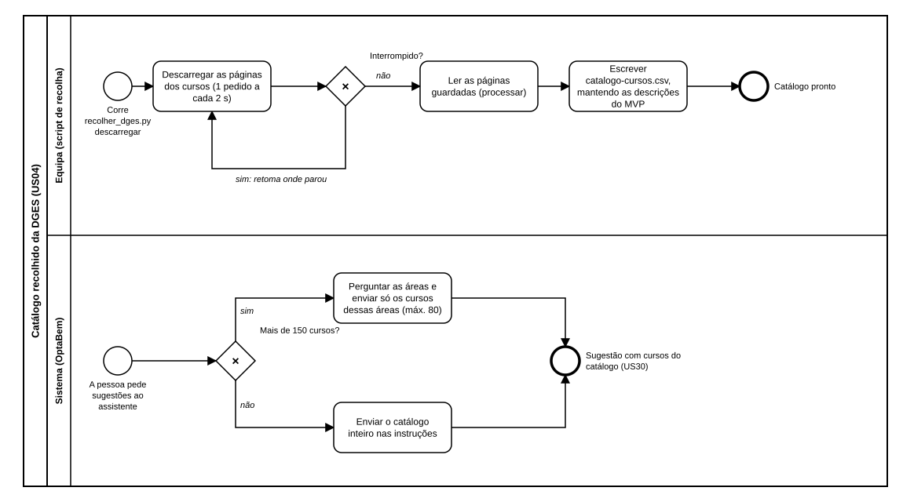

# US04 — Diagrama BPMN: catálogo de licenciaturas recolhido da DGES

O ficheiro editável é [diagramas/bpmn.bpmn](diagramas/bpmn.bpmn) (BPMN 2.0). Abre-se em [demo.bpmn.io](https://demo.bpmn.io) ou no Camunda Modeler. As duas versões são geradas por [diagramas/gerar.py](diagramas/gerar.py).

## Processo

O diagrama tem dois processos que se ligam pelo ficheiro `dados/catalogo-cursos.csv`:

1. **Recolha (equipa):** o script **descarrega as páginas dos cursos**, uma a cada 2 segundos. *Interrompido?* **sim:** retoma onde parou. **não:** **lê as páginas guardadas** e **escreve o CSV**, mantendo as descrições do MVP.
2. **Sugestão com o catálogo grande (sistema):** quando a pessoa pede sugestões, *mais de 150 cursos?* **sim:** o assistente indica as áreas e recebe só os cursos dessas áreas. **não:** recebe o catálogo inteiro. Em ambos os casos a sugestão só tem cursos do catálogo (US30).

## Como o diagrama se liga ao código

| Elemento BPMN | Código |
|---|---|
| Descarregar as páginas | `dados/recolher_dges.py`: `descarregar`, `_guardar` (retoma e novas tentativas), `ESPERA`, `PAUSAS` |
| Ler as páginas e escrever o CSV | `processar`, `ler_curso`, `_provas_ingresso`, `estatisticas` |
| Ler o catálogo | `app/config.py` (`CATALOGO_CSV`), `app/catalogo/repository.py` |
| Mais de 150 cursos? | `app/orientacao/conversa.py`: `MAX_CURSOS_DIRETO`, `proximo_passo` |
| Enviar só os cursos das áreas | `MAX_CURSOS_ENVIADOS` e a escolha dos candidatos em `conversa.py` |
