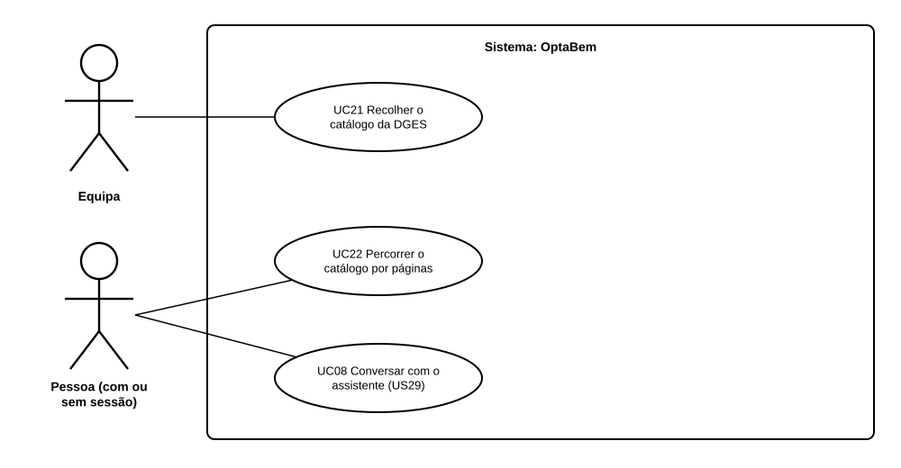

# US04 — Use case: catálogo de licenciaturas recolhido da DGES

## 1. Atores

| Ator | Tipo | Descrição |
|---|---|---|
| Equipa | Primário (UC21) | Um membro da equipa que corre o script no seu computador, com internet. |
| Pessoa | Primário (UC22, UC08) | Qualquer pessoa, com ou sem sessão iniciada. |
| Site da DGES | Secundário | Fornece as páginas públicas dos cursos. |

## 2. Lista de use cases

| ID | Nome | Requisitos |
|---|---|---|
| UC21 | Recolher o catálogo da DGES | RF05.1 a RF05.4 |
| UC22 | Percorrer o catálogo por páginas | RF05.5, RF05.6 |
| UC08 | Conversar com o assistente (US29), agora com filtro por área | RF05.7 |

## 3. UC21 — Recolher o catálogo da DGES

| | |
|---|---|
| **Objetivo** | Ter um CSV atualizado com os cursos e as condições de acesso publicadas pela DGES. |
| **Ator principal** | Equipa |
| **Pré-condições** | Python instalado e acesso à internet. |

**Fluxo principal:** (1) a equipa corre `python dados/recolher_dges.py descarregar`; (2) o script lê os índices da DGES e descarrega a página de cada curso, uma a cada 2 segundos, guardando-a em `dados/dges_html/`; (3) a equipa corre `processar`; (4) o script lê as páginas guardadas e escreve `dados/catalogo-cursos.csv`, mantendo as descrições do MVP.

**Alternativos:** a recolha é interrompida (rede, computador desligado) → ao correr outra vez, retoma onde parou; a DGES não responde → o script espera e tenta de novo; para um teste rápido, `amostra` (5 cursos) ou `mvp` (os cursos do MVP).

## 4. UC22 — Percorrer o catálogo por páginas

| | |
|---|---|
| **Ator principal** | Pessoa |
| **Pré-condições** | Nenhuma (não é preciso sessão). |

**Fluxo principal:** (1) a pessoa abre `/cursos/`; (2) o sistema mostra os primeiros 24 cursos e «página 1 de N»; (3) a pessoa vai para a página seguinte, com os filtros que tinha escolhido (US05); (4) abre a ficha de um curso (UC18).

**Alternativo:** número de página inválido → mostra a primeira ou a última.

## 5. UC08 com o catálogo grande

Com mais de 150 cursos, a sugestão do assistente (US29, US30) passa a ter dois passos: o LLM indica as áreas que combinam com a pessoa e a aplicação envia-lhe só os cursos dessas áreas (no máximo 80). Para a pessoa, a conversa é igual.
