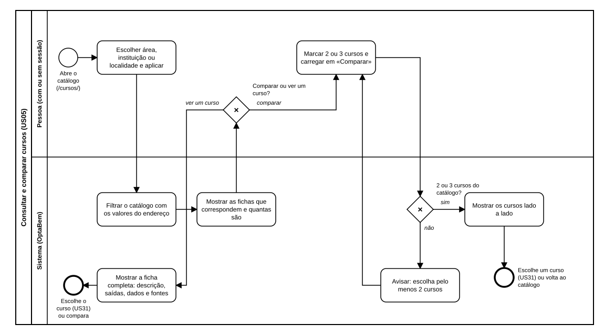

# US05 — Diagrama BPMN: consultar e comparar cursos

O ficheiro editável é [diagramas/bpmn.bpmn](diagramas/bpmn.bpmn) (BPMN 2.0). Abre-se em [demo.bpmn.io](https://demo.bpmn.io) ou no Camunda Modeler. As duas versões são geradas por [diagramas/gerar.py](diagramas/gerar.py).

## Processo

1. A pessoa **abre o catálogo** e **escolhe área, instituição ou localidade**.
2. O sistema **filtra o catálogo com os valores do endereço** e **mostra as fichas que correspondem**, com a contagem.
3. *Comparar ou ver um curso?*
   - **ver um curso:** o sistema mostra a ficha completa; a pessoa pode escolher o curso (US31) ou voltar e comparar.
   - **comparar:** a pessoa marca 2 ou 3 cursos e carrega em «Comparar». *2 ou 3 cursos do catálogo?* **sim:** o sistema mostra-os lado a lado. **não:** avisa e a pessoa volta a marcar.

## Como o diagrama se liga ao código

| Elemento BPMN | Código |
|---|---|
| Escolher filtros e aplicar | `templates/catalogo/lista.html` (formulário GET) |
| Filtrar o catálogo | `GET /cursos/` → `catalogo.routes.lista`; `services.ler_filtros`, `services.filtrar`, `services.opcoes` |
| Mostrar as fichas | macro `cartao_curso` em `templates/macros/marca.html` |
| Mostrar a ficha completa | `GET /cursos/<chave>` → `catalogo.routes.ficha`; `services.por_chave`; `templates/catalogo/ficha.html` |
| Marcar cursos e carregar em «Comparar» | caixa «Comparar» (`cartao_curso(…, comparar=true)`) e formulário `comparar-form` |
| 2 ou 3 cursos do catálogo? | `services.comparar`, `Comparacao.suficiente`, `MIN_COMPARAR`, `MAX_COMPARAR` |
| Mostrar lado a lado | `GET /cursos/comparar` → `catalogo.routes.comparar`; `templates/catalogo/comparar.html` |
| Escolhe um curso | US31: `percurso.routes.confirmar` |
