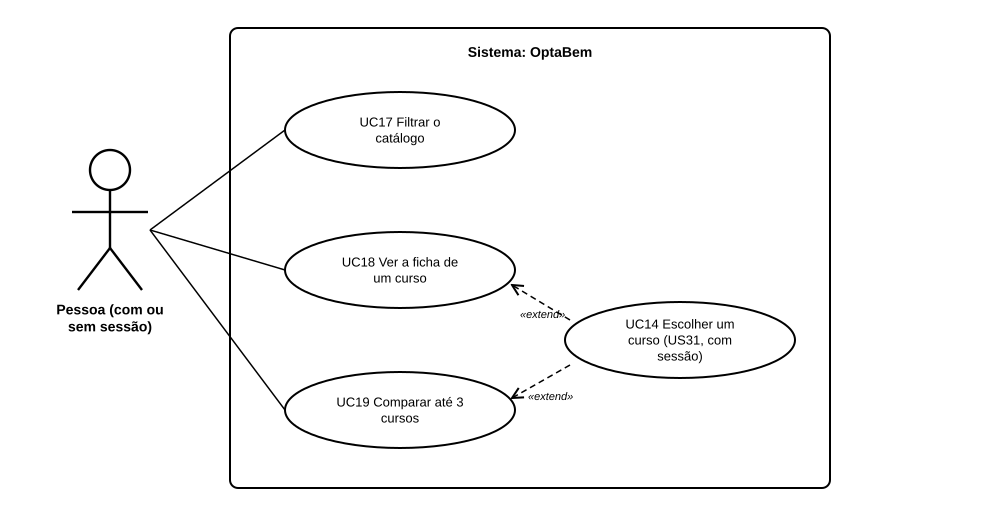

# US05 — Use case: consultar e comparar cursos

## 1. Atores

| Ator | Tipo | Descrição |
|---|---|---|
| Pessoa | Primário (UC17 a UC19) | Qualquer pessoa, com ou sem sessão iniciada. Com sessão de aluno pode também escolher um curso (UC14, da US31). |

## 2. Lista de use cases

| ID | Nome | Relações |
|---|---|---|
| UC17 | Filtrar o catálogo | — |
| UC18 | Ver a ficha de um curso | estendido por *UC14 Escolher um curso* (US31, com sessão) |
| UC19 | Comparar até 3 cursos | estendido por *UC14 Escolher um curso* (US31, com sessão) |

## 3. UC17 — Filtrar o catálogo

| | |
|---|---|
| **Objetivo** | Ficar só com os cursos que interessam. |
| **Ator principal** | Pessoa |
| **Pré-condições** | Nenhuma (não é preciso sessão). |
| **Requisitos** | RF34.1 a RF34.3 |

**Fluxo principal:** (1) a pessoa abre `/cursos/` e vê o catálogo todo; (2) escreve um termo e/ou escolhe área, instituição e localidade; (3) carrega em «Aplicar filtros»; (4) o sistema lê os filtros do endereço, ignora valores que não existem no catálogo e mostra as fichas que respeitam todos, com a contagem; (5) os valores escolhidos ficam selecionados.

**Alternativos:** nenhum curso corresponde → a página diz para tirar um filtro; «Limpar filtros» volta ao catálogo todo.

## 4. UC18 — Ver a ficha de um curso

| | |
|---|---|
| **Ator principal** | Pessoa |
| **Pré-condições** | Nenhuma. |
| **Requisitos** | RF34.4, RF34.5, RF34.9 |

**Fluxo principal:** (1) a pessoa carrega no nome de um curso (catálogo, página de apresentação ou sugestões da conversa); (2) o sistema mostra a ficha completa: números de acesso, descrição, saídas profissionais, dados do curso e fontes; (3) com sessão de aluno, a pessoa pode escolher o curso (UC14).

**Alternativo:** o curso não existe → «página não encontrada» (404).

## 5. UC19 — Comparar até 3 cursos

| | |
|---|---|
| **Ator principal** | Pessoa |
| **Pré-condições** | Nenhuma. |
| **Requisitos** | RF34.6 a RF34.9 |

**Fluxo principal:** (1) no catálogo, a pessoa marca «Comparar» em 2 ou 3 fichas; (2) carrega em «Comparar os cursos marcados»; (3) o sistema mostra os cursos lado a lado, pela ordem em que foram marcados; (4) com sessão de aluno, a pessoa pode escolher um deles (UC14).

**Alternativos:** menos de 2 cursos → a página explica e leva de volta ao catálogo; mais de 3 → comparam-se os 3 primeiros, com aviso; cursos repetidos ou inexistentes → ficam de fora, com aviso.
