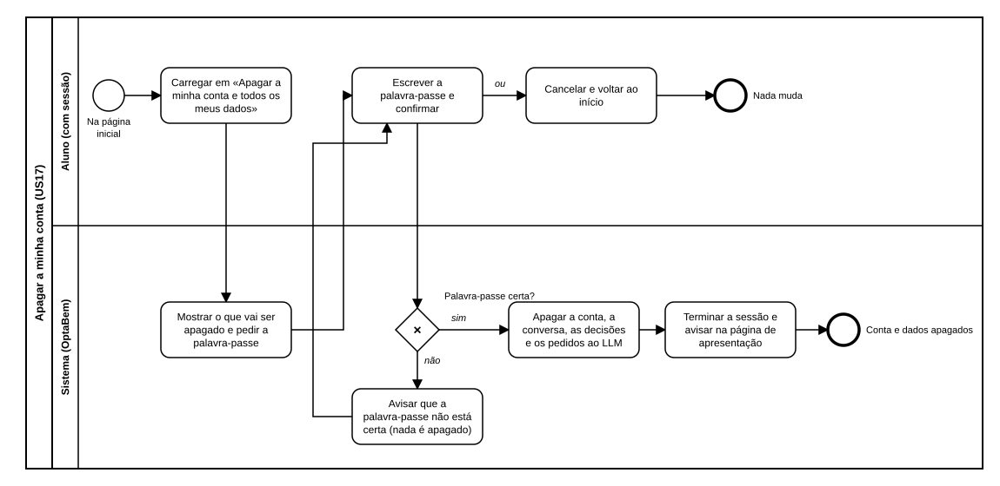

# US17 — Diagrama BPMN: apagar a minha conta

O ficheiro editável é [diagramas/bpmn.bpmn](diagramas/bpmn.bpmn) (BPMN 2.0). Abre-se em [demo.bpmn.io](https://demo.bpmn.io) ou no Camunda Modeler. As duas versões são geradas por [diagramas/gerar.py](diagramas/gerar.py).

## Processo

1. Na página inicial, o aluno **carrega em «Apagar a minha conta e todos os meus dados»**.
2. O sistema **mostra o que vai ser apagado e pede a palavra-passe**.
3. O aluno **escreve a palavra-passe e confirma**, ou cancela e nada muda.
4. *Palavra-passe certa?* **sim:** o sistema apaga a conta e todos os dados ligados, termina a sessão e avisa na página de apresentação. **não:** avisa e nada é apagado.

## Como o diagrama se liga ao código

| Elemento BPMN | Código |
|---|---|
| Carregar em «Apagar a minha conta…» | `templates/home.html` (secção «A sua conta») |
| Mostrar o que vai ser apagado | `GET /auth/conta/apagar` → `auth.routes.delete_account_form`; `templates/auth/apagar.html` |
| Escrever a palavra-passe e confirmar | `POST /auth/conta/apagar` → `auth.routes.delete_account_submit` (CSRF) |
| Palavra-passe certa? | `auth.services.delete_account` (`check_password_hash`) |
| Apagar a conta e os dados | `auth.repository.delete_user` e `ON DELETE CASCADE` em `app/schema.sql` |
| Terminar a sessão e avisar | `auth.sessions.logout_user`; `flash(texts.APAGAR_FEITO)`; avisos em `templates/base.html` |
