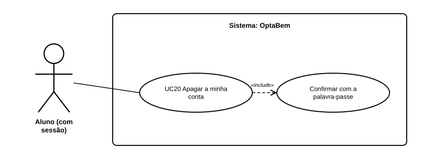

# US17 — Use case: apagar a minha conta

## 1. Atores

| Ator | Tipo | Descrição |
|---|---|---|
| Aluno | Primário (UC20) | Conta de aluno com sessão iniciada. Os administradores não têm esta opção. |

## 2. UC20 — Apagar a minha conta

| | |
|---|---|
| **Objetivo** | O aluno deixa de ter conta e nenhum dado seu fica no OptaBem. |
| **Ator principal** | Aluno |
| **Pré-condições** | Sessão de aluno iniciada. |
| **Relações** | inclui *Confirmar com a palavra-passe* |
| **Requisitos** | RF17.1 a RF17.6 |

**Fluxo principal:** (1) em «A minha conta», o aluno carrega em «Apagar a minha conta e todos os meus dados»; (2) o sistema mostra o que vai ser apagado e pede a palavra-passe; (3) o aluno escreve-a e confirma; (4) o sistema verifica a palavra-passe e apaga a conta, a conversa, as decisões e os pedidos ao LLM; (5) a sessão termina e a página de apresentação confirma que os dados foram apagados.

**Alternativos:** palavra-passe errada ou vazia → a página avisa e nada é apagado (volta ao passo 3); o aluno carrega em «Cancelar e voltar à minha conta» → nada muda.
