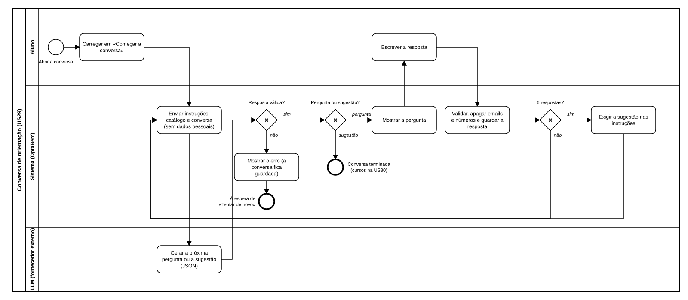

# US29 — Diagrama BPMN: conversa de orientação com o LLM

O ficheiro editável é [diagramas/bpmn.bpmn](diagramas/bpmn.bpmn) (BPMN 2.0). Abre-se em [demo.bpmn.io](https://demo.bpmn.io) ou no Camunda Modeler. As duas versões são geradas por [diagramas/gerar.py](diagramas/gerar.py).

## Processo

1. O aluno **abre a conversa** e carrega em **«Começar a conversa»**.
2. O sistema **envia ao LLM** as instruções, o catálogo e a conversa até ali, sem dados pessoais.
3. O LLM **gera a próxima pergunta ou a sugestão**, em JSON.
4. *Resposta válida?* **não** (falhou, demorou mais de 15 s ou veio fora do formato): o sistema mostra o erro, a conversa fica guardada e o processo espera por «Tentar de novo», que recomeça no passo 2.
5. *Pergunta ou sugestão?* **sugestão**: a conversa termina (os cursos são mostrados pela US30). **pergunta**: o sistema mostra-a.
6. O aluno **escreve a resposta**; o sistema valida-a, apaga emails e números longos e guarda-a.
7. *6 respostas?* **sim**: as instruções passam a exigir a sugestão. Em ambos os casos, volta ao passo 2.

## Como o diagrama se liga ao código

| Elemento BPMN | Código |
|---|---|
| Carregar em «Começar a conversa» | `POST /orientacao/comecar` → `services.comecar` |
| Enviar instruções, catálogo e conversa | `conversa.proximo_passo` (instruções em `app/orientacao/instrucoes.md`); `ProtegerDadosPessoais` em `app/llm/decoradores.py` |
| Gerar a próxima pergunta ou a sugestão | `ClienteLLM.conversar` (adaptador do fornecedor em `app/llm/adaptadores.py`) |
| Resposta válida? | `conversa.interpretar`; erros `ErroLLM` tratados em `routes._com_o_llm` |
| Mostrar o erro / Tentar de novo | `templates/orientacao/conversa.html`; `POST /orientacao/tentar-de-novo` → `services.continuar` |
| Pergunta ou sugestão? | `services._pedir_ao_llm` |
| Escrever a resposta / Validar, apagar e guardar | `POST /orientacao/responder` → `services.validar_resposta`, `remover_dados_pessoais`, `repository.guardar` |
| 6 respostas? / Exigir a sugestão | `conversa.LIMITE_PERGUNTAS`, `conversa.PEDIDO_DE_SUGESTAO` |
