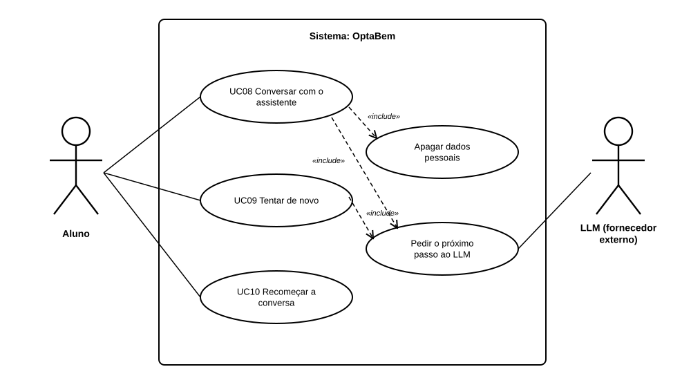

# US29 — Use case: conversa de orientação com o LLM

## 1. Atores

| Ator | Tipo | Descrição |
|---|---|---|
| Aluno | Primário (UC08 a UC10) | Conta de aluno com sessão iniciada, ainda sem curso escolhido. |
| LLM (fornecedor externo) | Secundário | Google Gemini por omissão (Groq como reserva), através do `ClienteLLM`. Não recebe dados da conta. |

## 2. Lista de use cases

| ID | Nome | Relações |
|---|---|---|
| UC08 | Conversar com o assistente | inclui *Apagar dados pessoais* e *Pedir o próximo passo ao LLM* |
| UC09 | Tentar de novo | inclui *Pedir o próximo passo ao LLM* |
| UC10 | Recomeçar a conversa | — |

## 3. UC08 — Conversar com o assistente

| | |
|---|---|
| **Objetivo** | O assistente descobre os interesses do aluno, para depois sugerir cursos (US30). |
| **Ator principal** | Aluno |
| **Pré-condições** | Sessão de aluno iniciada. |
| **Requisitos** | RF36.1 a RF36.6, RF36.8, RF36.10, RNF12 |

**Fluxo principal:** (1) o aluno abre a conversa (pela linha do tempo ou em `/orientacao/`) e lê o aviso de privacidade; (2) carrega em «Começar a conversa»; (3) o sistema envia ao LLM as instruções, o catálogo e a conversa; (4) o LLM devolve uma pergunta, que o sistema guarda e mostra; (5) o aluno escreve a resposta; (6) o sistema valida-a, apaga emails e números longos, guarda-a e volta ao passo 3; (7) ao fim de, no máximo, 6 respostas, o LLM devolve a sugestão e a conversa termina.

**Alternativos:** resposta vazia ou longa → erro junto da caixa, o texto mantém-se (passo 5); o LLM falha ou demora mais de 15 s → UC09; o aluno quer começar de novo → UC10.

## 4. UC09 — Tentar de novo

| | |
|---|---|
| **Ator principal** | Aluno |
| **Pré-condições** | O último pedido ao LLM falhou; a resposta do aluno está guardada. |
| **Requisitos** | RF36.9 |

**Fluxo principal:** (1) a página mostra a mensagem de erro e «Tentar de novo»; (2) o aluno carrega no botão; (3) o sistema repete o pedido com a conversa guardada e continua no passo 4 do UC08.

## 5. UC10 — Recomeçar a conversa

| | |
|---|---|
| **Ator principal** | Aluno |
| **Requisitos** | RF36.7 |

**Fluxo principal:** (1) o aluno carrega em «Recomeçar a conversa»; (2) o sistema apaga a conversa guardada e mostra outra vez «Começar a conversa».

## 6. Rastreabilidade

| Use case | Requisitos | Código | Testes |
|---|---|---|---|
| UC08 | RF36.1 a RF36.6, RF36.8, RF36.10, RNF12 | `routes.comecar`, `routes.responder`, `services.comecar`, `services.responder`, `conversa.proximo_passo` | `ConversaConduzidaPeloLLMTests`, `DadosPessoaisTests`, `AcessoTests`, `PercursoTests` |
| UC09 | RF36.9 | `routes.tentar_de_novo`, `services.continuar` | `FalhasDoLLMTests` |
| UC10 | RF36.7 | `routes.recomecar`, `services.recomecar` | `RecomecarTests` |
