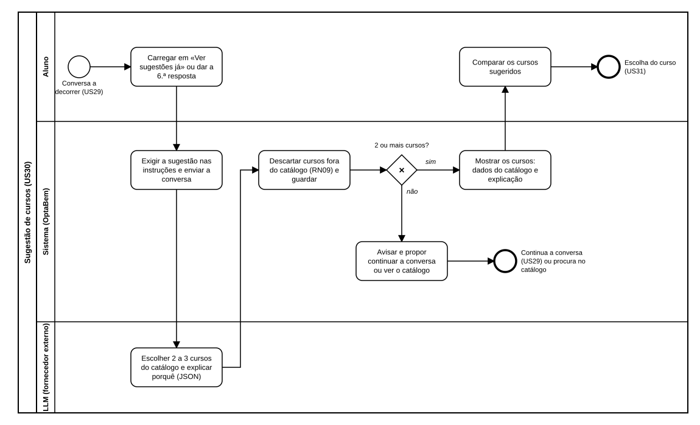

# US30 — Diagrama BPMN: sugestão de 2 a 3 cursos

O ficheiro editável é [diagramas/bpmn.bpmn](diagramas/bpmn.bpmn) (BPMN 2.0). Abre-se em [demo.bpmn.io](https://demo.bpmn.io) ou no Camunda Modeler. As duas versões são geradas por [diagramas/gerar.py](diagramas/gerar.py).

## Processo

1. Durante a conversa (US29), o aluno **carrega em «Ver sugestões já»** ou dá a 6.ª resposta.
2. O sistema **exige a sugestão nas instruções e envia a conversa** ao LLM, sem dados pessoais.
3. O LLM **escolhe 2 a 3 cursos do catálogo e explica porquê**, em JSON.
4. O sistema **descarta os cursos fora do catálogo** (RN09) e guarda a sugestão.
5. *2 ou mais cursos?* **sim**: o sistema mostra os cursos com os dados do catálogo e a explicação; o aluno compara-os e a escolha fica para a US31. **não**: o sistema avisa e propõe continuar a conversa (volta à US29) ou procurar no catálogo.

O caso de o LLM falhar é o da US29 (mensagem clara e «Tentar de novo») e não se repete aqui.

## Como o diagrama se liga ao código

| Elemento BPMN | Código |
|---|---|
| Carregar em «Ver sugestões já» | `POST /orientacao/sugerir` → `services.pedir_sugestao` |
| Dar a 6.ª resposta | `POST /orientacao/responder` → `services.responder`; `conversa.LIMITE_PERGUNTAS` |
| Exigir a sugestão e enviar a conversa | `conversa.proximo_passo(..., forcar_sugestao=True)`, `conversa.PEDIDO_DE_SUGESTAO` |
| Escolher cursos e explicar | `ClienteLLM.conversar`; formato em `app/orientacao/instrucoes.md` |
| Descartar cursos fora do catálogo e guardar | `conversa.validar_contra_catalogo`; `services._pedir_ao_llm` |
| 2 ou mais cursos? | `EstadoConversa.sugestao_suficiente`, `conversa.MIN_CURSOS_SUGERIDOS` |
| Mostrar os cursos | `services.cursos_sugeridos` (volta a validar); `templates/orientacao/conversa.html`; macro `cartao_curso` em `templates/macros/marca.html` |
| Avisar e propor continuar ou ver o catálogo | `POST /orientacao/continuar` → `services.continuar_conversa`; `GET /cursos/` → `catalogo.routes.lista` |
| Escolha do curso | US31 (por fazer) |
