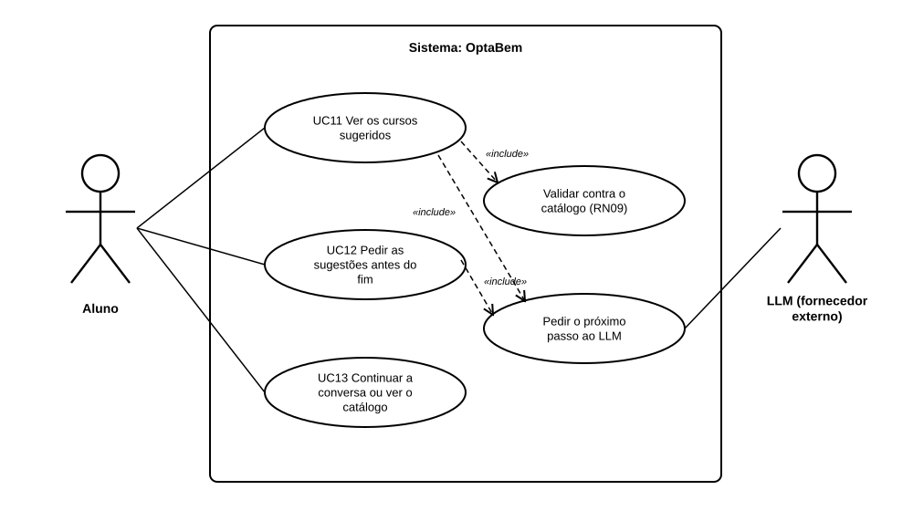

# US30 — Use case: sugestão de 2 a 3 cursos no fim da conversa

## 1. Atores

| Ator | Tipo | Descrição |
|---|---|---|
| Aluno | Primário (UC11 a UC13) | Conta de aluno com sessão iniciada, a meio ou no fim da conversa de orientação (US29). |
| LLM (fornecedor externo) | Secundário | Google Gemini por omissão (Groq como reserva), através do `ClienteLLM`. Não recebe dados da conta. |

## 2. Lista de use cases

| ID | Nome | Relações |
|---|---|---|
| UC11 | Ver os cursos sugeridos | inclui *Validar contra o catálogo (RN09)* e *Pedir o próximo passo ao LLM* |
| UC12 | Pedir as sugestões antes do fim | inclui *Pedir o próximo passo ao LLM* |
| UC13 | Continuar a conversa ou ver o catálogo | — |

## 3. UC11 — Ver os cursos sugeridos

| | |
|---|---|
| **Objetivo** | O aluno fica com 2 a 3 cursos do catálogo por onde começar, cada um com o motivo. |
| **Ator principal** | Aluno |
| **Pré-condições** | Sessão de aluno iniciada; conversa de orientação começada (US29). |
| **Requisitos** | RF37.1, RF37.3 a RF37.5, RF37.9 |

**Fluxo principal:** (1) o aluno dá a última resposta (a 6.ª, ou antes, se o LLM já tiver informação suficiente) ou pede as sugestões (UC12); (2) o sistema envia ao LLM a conversa e, se for o caso, exige a sugestão; (3) o LLM devolve 2 a 3 identificadores de cursos com uma explicação cada; (4) o sistema descarta os que não estão no catálogo e guarda a sugestão; (5) a página mostra os cursos, com os dados do catálogo e a explicação, e diz que nenhum foi escolhido; (6) na página inicial, o percurso passa a «Escolher curso».

**Alternativos:** sobram menos de 2 cursos → UC13; o LLM falha → «Tentar de novo» (UC09 da US29).

## 4. UC12 — Pedir as sugestões antes do fim

| | |
|---|---|
| **Ator principal** | Aluno |
| **Pré-condições** | O aluno já deu pelo menos uma resposta; a conversa não terminou nem está à espera do assistente. |
| **Requisitos** | RF37.2 |

**Fluxo principal:** (1) o aluno carrega em «Ver sugestões já»; (2) o sistema junta à conversa o pedido «Prefiro ver já as sugestões de curso.» e guarda-o; (3) continua no passo 2 do UC11, com a sugestão exigida.

**Alternativo:** o LLM falha → a página mostra o erro; «Tentar de novo» volta a exigir a sugestão.

## 5. UC13 — Continuar a conversa ou ver o catálogo

| | |
|---|---|
| **Ator principal** | Aluno |
| **Pré-condições** | A conversa terminou com menos de 2 cursos do catálogo. |
| **Requisitos** | RF37.6 a RF37.8 |

**Fluxo principal:** (1) a página diz que o assistente não encontrou cursos suficientes; (2a) o aluno carrega em «Continuar a conversa»: o sistema apaga a sugestão, mantém as mensagens e mostra a caixa de resposta; a resposta seguinte volta ao UC11; **ou** (2b) o aluno carrega em «Procurar no catálogo» e pesquisa em `/cursos/`.
