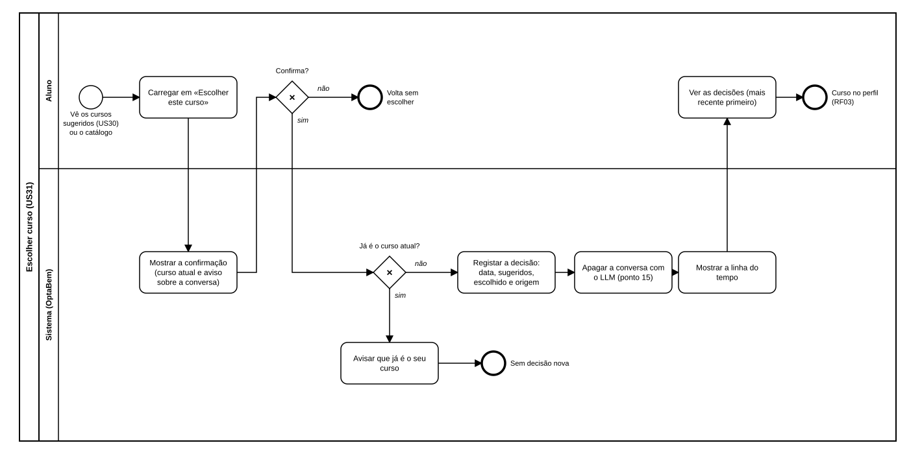

# US31 — Diagrama BPMN: escolher curso e linha do tempo

O ficheiro editável é [diagramas/bpmn.bpmn](diagramas/bpmn.bpmn) (BPMN 2.0). Abre-se em [demo.bpmn.io](https://demo.bpmn.io) ou no Camunda Modeler. As duas versões são geradas por [diagramas/gerar.py](diagramas/gerar.py).

## Processo

1. O aluno vê os cursos sugeridos (US30) ou o catálogo e **carrega em «Escolher este curso»**.
2. O sistema **mostra a confirmação**: a ficha do curso, o curso atual (se houver) e o aviso de que a conversa vai ser apagada.
3. *Confirma?* **não**: volta sem escolher; nada é registado (RN10).
4. **sim**: *Já é o curso atual?* **sim**: o sistema avisa e não cria decisão nova.
5. **não**: o sistema **regista a decisão** (data, cursos sugeridos, curso escolhido e origem) e **apaga a conversa com o LLM** (ponto 15).
6. O sistema **mostra a linha do tempo** e o aluno vê as decisões, da mais recente para a mais antiga. O curso fica no perfil (RF03).

## Como o diagrama se liga ao código

| Elemento BPMN | Código |
|---|---|
| Carregar em «Escolher este curso» | `marca.cartao_curso(…, escolher=true)` em `orientacao/conversa.html` e `catalogo/lista.html` |
| Mostrar a confirmação | `GET /percurso/escolher/<chave>` → `routes.confirmar`, `templates/percurso/escolher.html` |
| Confirma? | Botão «Confirmar a escolha»: `POST /percurso/escolher/<chave>` → `routes.escolher` |
| Já é o curso atual? / Avisar | `services.escolher` levanta `MesmoCurso`; mensagem `PERCURSO_JA_E_O_SEU_CURSO` |
| Registar a decisão | `services.escolher` → `repository.inserir` (tabela `decisoes`) |
| Apagar a conversa com o LLM | `orientacao.services.recomecar` |
| Mostrar a linha do tempo / Ver as decisões | `GET /percurso/` → `routes.linha_tempo`, `services.decisoes`, `templates/percurso/linha_tempo.html` |
| Curso no perfil | `services.curso_atual`; página inicial em `main.home` e `percurso.passos` |
