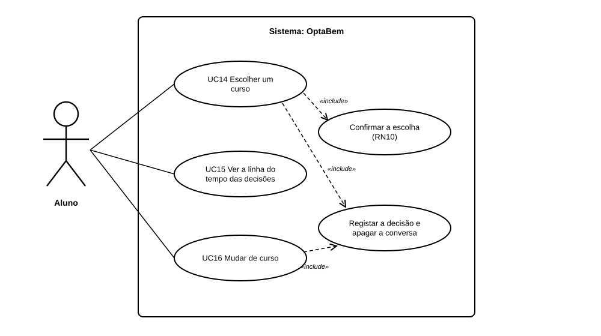

# US31 — Use case: escolher curso e linha do tempo do percurso

## 1. Atores

| Ator | Tipo | Descrição |
|---|---|---|
| Aluno | Primário (UC14 a UC16) | Conta de aluno com sessão iniciada, com ou sem cursos sugeridos pelo assistente. |

O LLM não participa: a escolha usa as sugestões já guardadas pela US30.

## 2. Lista de use cases

| ID | Nome | Relações |
|---|---|---|
| UC14 | Escolher um curso | inclui *Confirmar a escolha (RN10)* e *Registar a decisão e apagar a conversa* |
| UC15 | Ver a linha do tempo das decisões | — |
| UC16 | Mudar de curso | inclui *Registar a decisão e apagar a conversa* (passa pelo UC14) |

## 3. UC14 — Escolher um curso

| | |
|---|---|
| **Objetivo** | O aluno fica com um curso no perfil, escolhido por ele. |
| **Ator principal** | Aluno |
| **Pré-condições** | Sessão de aluno iniciada; o curso existe no catálogo. |
| **Requisitos** | RF39.1 a RF39.3, RF35.1, RF03.1, RF39.5 |

**Fluxo principal:** (1) nos cursos sugeridos (US30) ou na página `/cursos/`, o aluno carrega em «Escolher este curso»; (2) o sistema mostra a confirmação, com a ficha do curso e o aviso de que a conversa com o assistente vai ser apagada; (3) o aluno carrega em «Confirmar a escolha»; (4) o sistema regista a decisão (data, curso, instituição, cursos sugeridos nessa altura e origem); (5) apaga a conversa com o LLM; (6) mostra a linha do tempo com a mensagem «Escolha registada»; (7) a página inicial passa a mostrar o curso.

**Alternativos:** o aluno volta sem confirmar → nada é registado (passo 3); o curso já é o curso atual → a confirmação diz isso e não há botão; se o pedido chegar na mesma, não é criada decisão nova (passo 4); o identificador não existe no catálogo → «página não encontrada».

## 4. UC15 — Ver a linha do tempo das decisões

| | |
|---|---|
| **Ator principal** | Aluno |
| **Requisitos** | RF35.2 |

**Fluxo principal:** (1) o aluno abre «Ver as minhas decisões» na página inicial (ou `/percurso/`); (2) o sistema mostra as decisões da mais recente para a mais antiga, a primeira como «Curso atual», cada uma com a data, a origem e os cursos sugeridos.

**Alternativo:** sem decisões → «Ainda não escolheu nenhum curso», com as ligações para conversar com o assistente ou procurar no catálogo.

## 5. UC16 — Mudar de curso

| | |
|---|---|
| **Ator principal** | Aluno |
| **Pré-condições** | O aluno já tem um curso escolhido. |
| **Requisitos** | RF39.4 |

**Fluxo principal:** (1) na linha do tempo, o aluno escolhe «Nova conversa com o assistente» ou «Procurar no catálogo»; (2) chega a um curso diferente e segue o UC14, em que a confirmação mostra também o curso atual; (3) o sistema cria uma decisão nova, que passa a ser o curso atual; as anteriores ficam na linha do tempo.

## 6. Rastreabilidade

| Use case | Requisitos | Código | Testes |
|---|---|---|---|
| UC14 | RF39.1 a RF39.3, RF35.1, RF03.1, RF39.5 | `percurso.routes.confirmar`, `percurso.routes.escolher`, `percurso.services.escolher`, `macros/marca.html` (`cartao_curso(…, escolher=true)`) | `EscolhaConfirmadaTests`, `AcessoTests`, `CursoNoPerfilTests`, `DecisaoRegistadaTests`, `CatalogoTests` |
| UC15 | RF35.2 | `percurso.routes.linha_tempo`, `percurso.services.decisoes` | `LinhaDoTempoTests` |
| UC16 | RF39.4 | `percurso.services.escolher` (`MesmoCurso`), `percurso/escolher.html` | `MudarDeCursoTests` |
