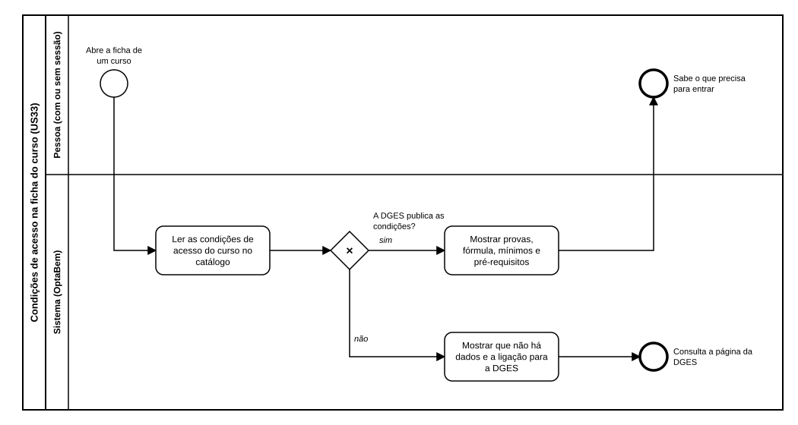

# US33 — Diagrama BPMN: condições de acesso na ficha do curso

O ficheiro editável é [diagramas/bpmn.bpmn](diagramas/bpmn.bpmn) (BPMN 2.0). Abre-se em [demo.bpmn.io](https://demo.bpmn.io) ou no Camunda Modeler. As duas versões são geradas por [diagramas/gerar.py](diagramas/gerar.py).

## Processo

1. A pessoa **abre a ficha de um curso**.
2. O sistema **lê as condições de acesso do curso no catálogo**.
3. *A DGES publica as condições?* **sim:** o sistema mostra as provas (pelo nome), a fórmula, os mínimos e os pré-requisitos. **não:** diz que não há dados e a pessoa consulta a página da DGES.

## Como o diagrama se liga ao código

| Elemento BPMN | Código |
|---|---|
| Ler as condições de acesso | `app/catalogo/repository.py` (`Curso`, `nomes_das_provas`) |
| A DGES publica as condições? | `Curso.tem_condicoes_de_acesso` |
| Mostrar provas, fórmula, mínimos e pré-requisitos | macro `condicoes` em `templates/macros/candidatura.html`, usada em `templates/catalogo/ficha.html` |
| Mostrar que não há dados | `texts.FICHA_SEM_ACESSO`; ligação da DGES em «Fontes» |
