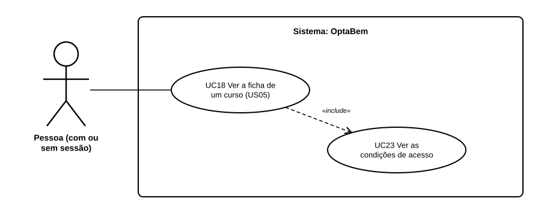

# US33 — Use case: condições de acesso na ficha do curso

## 1. Atores

| Ator | Tipo | Descrição |
|---|---|---|
| Pessoa | Primário | Qualquer pessoa, com ou sem sessão iniciada. |

## 2. Lista de use cases

| ID | Nome | Relações |
|---|---|---|
| UC18 | Ver a ficha de um curso (US05) | inclui *UC23* |
| UC23 | Ver as condições de acesso | incluído em *UC18* |

## 3. UC23 — Ver as condições de acesso

| | |
|---|---|
| **Objetivo** | Saber que exames e que notas são precisos para concorrer a um curso. |
| **Ator principal** | Pessoa |
| **Pré-condições** | Nenhuma (não é preciso sessão). |
| **Requisitos** | RF40.2 a RF40.5 |

**Fluxo principal:** (1) a pessoa abre a ficha de um curso (UC18); (2) o sistema lê as condições de acesso do curso no catálogo; (3) mostra os conjuntos de provas pelo nome, a fórmula, os mínimos e, se houver, os pré-requisitos.

**Alternativo:** o curso não tem condições no catálogo → a ficha diz isso e a pessoa usa a ligação para a página da DGES.
