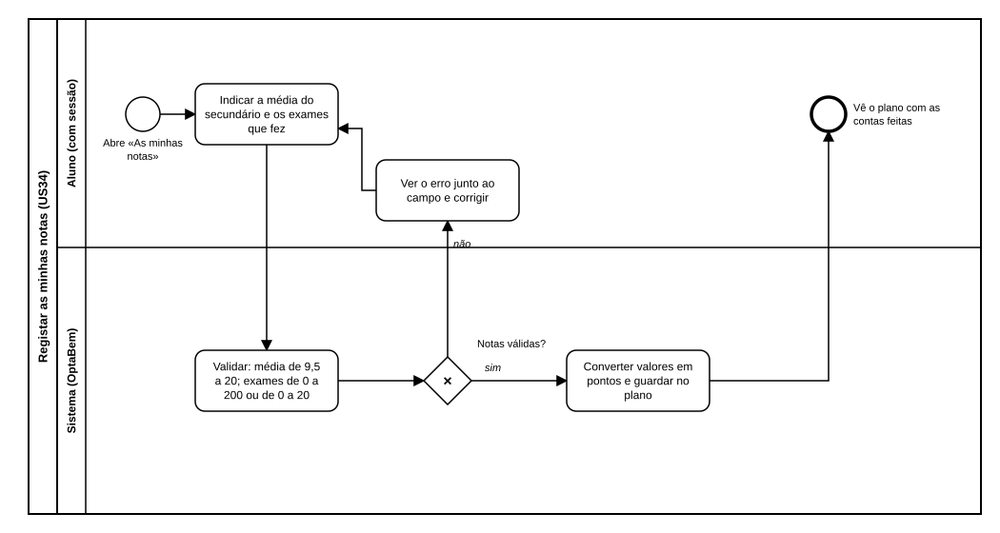

# US34 — Diagrama BPMN: registar as minhas notas

O ficheiro editável é [diagramas/bpmn.bpmn](diagramas/bpmn.bpmn) (BPMN 2.0). Abre-se em [demo.bpmn.io](https://demo.bpmn.io) ou no Camunda Modeler. As duas versões são geradas por [diagramas/gerar.py](diagramas/gerar.py).

## Processo

1. O aluno **abre «As minhas notas»** e **indica a média do secundário e os exames que fez**.
2. O sistema **valida** (média de 9,5 a 20; exames de 0 a 200 ou de 0 a 20).
3. *Notas válidas?* **não:** o aluno vê o erro junto ao campo e corrige. **sim:** o sistema **converte valores em pontos e guarda no plano**, e o aluno vê o plano com as contas feitas.

## Como o diagrama se liga ao código

| Elemento BPMN | Código |
|---|---|
| Abre «As minhas notas» | `GET /candidatura/notas` → `candidatura.routes.notas`; `templates/candidatura/notas.html` |
| Validar | `services.ler_notas`; `calculos.ler_numero` |
| Notas válidas? | dicionário `erros` devolvido por `ler_notas` |
| Ver o erro | resposta 422 com `erros` |
| Converter e guardar | `calculos.nota_de_exame`; `services.guardar_notas`; `repository.guardar` |
