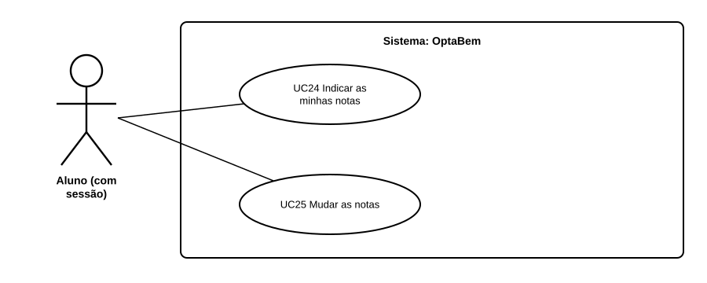

# US34 — Use case: registar as minhas notas

## 1. Atores

| Ator | Tipo | Descrição |
|---|---|---|
| Aluno | Primário (UC24, UC25) | Conta de aluno com sessão iniciada. |

## 2. Lista de use cases

| ID | Nome | Requisitos |
|---|---|---|
| UC24 | Indicar as minhas notas | RF41.1 a RF41.6 |
| UC25 | Mudar as notas | RF41.6 |

## 3. UC24 — Indicar as minhas notas

| | |
|---|---|
| **Objetivo** | Dar ao OptaBem as notas de que precisa para calcular a nota de candidatura. |
| **Ator principal** | Aluno |
| **Pré-condições** | Sessão iniciada. |

**Fluxo principal:** (1) o aluno abre «As minhas notas» (no plano ou na ficha de um curso); (2) indica a média do secundário e os exames que fez; (3) carrega em «Guardar e ver o plano»; (4) o sistema valida, converte valores em pontos e guarda; (5) mostra o plano com «Notas guardadas.».

**Alternativos:** média vazia ou fora de 9,5 a 20, ou exame inválido → nada é guardado e o erro aparece junto ao campo.

## 4. UC25 — Mudar as notas

Igual ao UC24: o formulário abre com os valores guardados, e o aluno muda o que quiser. As contas do plano (US35, US36) atualizam-se logo.
