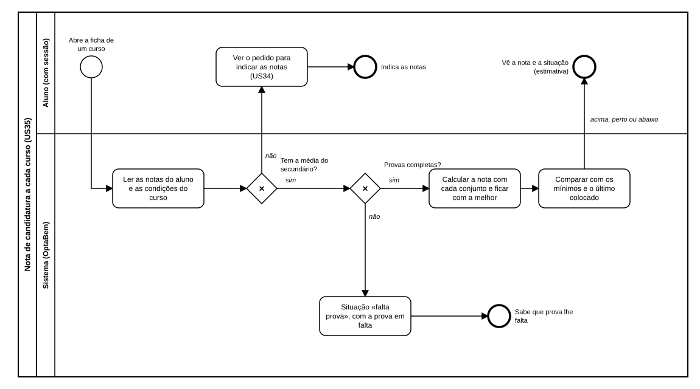

# US35 — Diagrama BPMN: nota de candidatura a cada curso

O ficheiro editável é [diagramas/bpmn.bpmn](diagramas/bpmn.bpmn) (BPMN 2.0). Abre-se em [demo.bpmn.io](https://demo.bpmn.io) ou no Camunda Modeler. As duas versões são geradas por [diagramas/gerar.py](diagramas/gerar.py).

## Processo

1. O aluno **abre a ficha de um curso**.
2. O sistema **lê as notas do aluno e as condições do curso**.
3. *Tem a média do secundário?* **não:** o aluno vê o pedido para indicar as notas (US34). **sim:** continua.
4. *Provas completas?* **não:** situação «falta prova», com a prova em falta. **sim:** o sistema **calcula a nota com cada conjunto e fica com a melhor**, **compara com os mínimos e o último colocado** e o aluno vê a nota e a situação (estimativa).

## Como o diagrama se liga ao código

| Elemento BPMN | Código |
|---|---|
| Ler as notas e as condições | `catalogo.routes.ficha`: `candidatura.services.obter`, `catalogo.services.por_chave` |
| Tem a média? / Provas completas? | `calculos.simular` (`Situacao.SEM_NOTAS`, `Situacao.FALTA_PROVA`) |
| Calcular a nota com cada conjunto | `calculos.simular` (ciclo pelos conjuntos completos) |
| Comparar com os mínimos e o último colocado | `calculos._comparar`, `MARGEM`; `Situacao.ABAIXO_DO_MINIMO` |
| Ver a nota e a situação | macro `situacao`; `templates/catalogo/ficha.html` |
