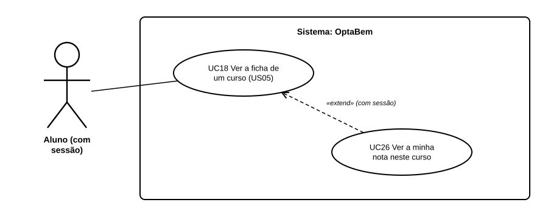

# US35 — Use case: nota de candidatura a cada curso

## 1. Atores

| Ator | Tipo | Descrição |
|---|---|---|
| Aluno | Primário | Conta de aluno com sessão iniciada. |

## 2. Lista de use cases

| ID | Nome | Relações |
|---|---|---|
| UC18 | Ver a ficha de um curso (US05) | estendido por *UC26* |
| UC26 | Ver a minha nota neste curso | estende *UC18*, com sessão iniciada |

## 3. UC26 — Ver a minha nota neste curso

| | |
|---|---|
| **Objetivo** | Saber se a nota chega para entrar num curso. |
| **Ator principal** | Aluno |
| **Pré-condições** | Sessão iniciada. |
| **Requisitos** | RF42.1 a RF42.7 |

**Fluxo principal:** (1) o aluno abre a ficha de um curso; (2) o sistema lê as notas do aluno e as condições do curso; (3) calcula a nota com cada conjunto de provas completo e fica com a melhor; (4) compara-a com os mínimos e com o último colocado; (5) mostra a nota, a situação, as provas que contaram e o aviso de estimativa.

**Alternativos:** sem média → pede as notas (US34); nenhum conjunto completo → «falta prova», com a prova em falta; abaixo de um mínimo → diz qual; curso sem condições → diz que a DGES não as publica.
