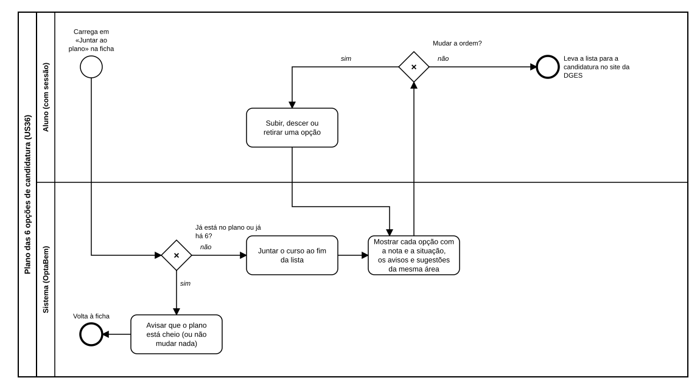

# US36 — Diagrama BPMN: plano das 6 opções de candidatura

O ficheiro editável é [diagramas/bpmn.bpmn](diagramas/bpmn.bpmn) (BPMN 2.0). Abre-se em [demo.bpmn.io](https://demo.bpmn.io) ou no Camunda Modeler. As duas versões são geradas por [diagramas/gerar.py](diagramas/gerar.py).

## Processo

1. O aluno **carrega em «Juntar ao plano»** na ficha de um curso.
2. *Já está no plano ou já há 6?* **sim:** o sistema avisa que o plano está cheio (ou não muda nada) e o aluno volta à ficha. **não:** o sistema **junta o curso ao fim da lista**.
3. O sistema **mostra cada opção com a nota e a situação, os avisos e as sugestões da mesma área**.
4. *Mudar a ordem?* **sim:** o aluno **sobe, desce ou retira uma opção** e o plano volta a ser mostrado. **não:** o aluno leva a lista para a candidatura no site da DGES.

## Como o diagrama se liga ao código

| Elemento BPMN | Código |
|---|---|
| Juntar ao plano | `POST /candidatura/juntar/<curso>` → `candidatura.routes.juntar` |
| Já está no plano ou já há 6? | `services.juntar` (devolve `False` se já está; `PlanoCheio` se há 6) |
| Juntar ao fim da lista | `services.juntar`, `repository.guardar` |
| Mostrar o plano | `GET /candidatura/` → `candidatura.routes.plano`; `services.opcoes`, `services.avisos`, `services.sugestoes`; `templates/candidatura/plano.html` |
| Subir, descer ou retirar | `POST /candidatura/subir`, `descer`, `retirar` → `services.mover`, `services.retirar` |
