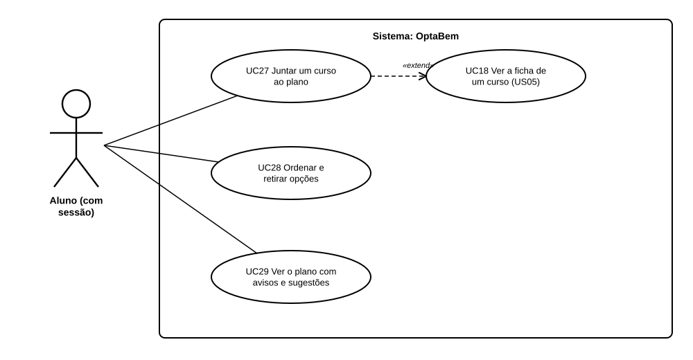

# US36 — Use case: plano das 6 opções de candidatura

## 1. Atores

| Ator | Tipo | Descrição |
|---|---|---|
| Aluno | Primário (UC27 a UC29) | Conta de aluno com sessão iniciada. |

## 2. Lista de use cases

| ID | Nome | Relações |
|---|---|---|
| UC27 | Juntar um curso ao plano | estende *UC18 Ver a ficha de um curso* (US05) |
| UC28 | Ordenar e retirar opções | — |
| UC29 | Ver o plano com avisos e sugestões | — |

## 3. UC27 — Juntar um curso ao plano

| | |
|---|---|
| **Ator principal** | Aluno |
| **Pré-condições** | Sessão iniciada; ficha de um curso aberta. |
| **Requisitos** | RF43.1, RF43.2, RF43.7 |

**Fluxo principal:** (1) na ficha, o aluno carrega em «Juntar ao plano»; (2) o sistema junta o curso ao fim da lista; (3) a ficha confirma e mostra «Já está no seu plano».

**Alternativos:** o curso já está no plano → nada muda; o plano já tem 6 opções → aviso para retirar uma; o curso não existe → 404.

## 4. UC28 — Ordenar e retirar opções

| | |
|---|---|
| **Ator principal** | Aluno |
| **Pré-condições** | Pelo menos uma opção no plano. |
| **Requisitos** | RF43.3, RF43.4 |

**Fluxo principal:** (1) no plano, o aluno carrega em «Subir», «Descer» ou «Retirar» numa opção; (2) o sistema muda a lista e volta a mostrar o plano.

**Alternativo:** subir a 1.ª ou descer a última → nada muda.

## 5. UC29 — Ver o plano com avisos e sugestões

| | |
|---|---|
| **Ator principal** | Aluno |
| **Pré-condições** | Sessão iniciada. |
| **Requisitos** | RF43.3, RF43.5, RF43.6, RF43.8, RF43.9 |

**Fluxo principal:** (1) o aluno abre «Candidatura» no menu ou o passo «Preparar a candidatura» na página inicial; (2) o sistema mostra as notas, cada opção com a nota e a situação, os avisos «Antes de submeter» e até 3 cursos da mesma área onde o aluno tem hipóteses.

**Alternativos:** plano vazio → explica como juntar cursos (e, se o aluno já escolheu um curso na US31, oferece juntá-lo como 1.ª opção); sem notas → pede as notas (US34).
