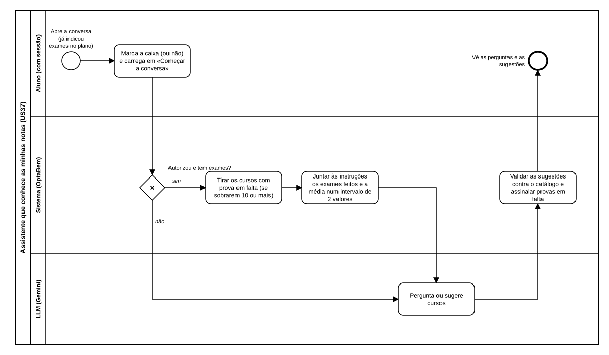

# US37 — Diagrama BPMN: assistente que conhece as minhas notas

O ficheiro editável é [diagramas/bpmn.bpmn](diagramas/bpmn.bpmn) (BPMN 2.0). Abre-se em [demo.bpmn.io](https://demo.bpmn.io) ou no Camunda Modeler. As duas versões são geradas por [diagramas/gerar.py](diagramas/gerar.py).

## Processo

1. O aluno **abre a conversa** (já indicou exames no plano) e **marca a caixa (ou não)** antes de carregar em «Começar a conversa».
2. *Autorizou e tem exames?* **não:** a conversa segue como na US29. **sim:** o sistema **tira os cursos com prova em falta** (se sobrarem 10 ou mais) e **junta às instruções os exames feitos e a média num intervalo de 2 valores**.
3. O LLM **pergunta ou sugere cursos**.
4. O sistema **valida as sugestões contra o catálogo e assinala as provas em falta**; o aluno **vê as perguntas e as sugestões**.

## Como o diagrama se liga ao código

| Elemento BPMN | Código |
|---|---|
| Marca a caixa | `POST /orientacao/comecar` com `usar_notas` → `orientacao/services.comecar` |
| Autorizou e tem exames? | `orientacao/services.pode_usar_notas` |
| Tirar os cursos com prova em falta | `orientacao/notas.cursos_para_enviar`, `candidatura/calculos.provas_em_falta` |
| Juntar às instruções | `orientacao/notas.contexto`, `orientacao/conversa.proximo_passo(..., contexto=)` |
| Validar e assinalar | `orientacao/services.em_falta_nas_sugestoes`; o aviso em `cartao_curso(..., aviso=)` |
