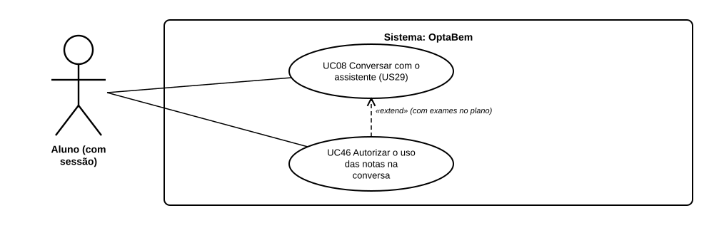

# US37 — Use case: assistente que conhece as minhas notas

## 1. Atores

| Ator | Tipo | Descrição |
|---|---|---|
| Aluno (com sessão) | Primário | Pessoa com conta, que já indicou exames no plano de candidatura (US34). |
| LLM (Gemini) | Secundário | Serviço externo que faz as perguntas e sugere cursos (US29, US30). |

## 2. Lista de use cases

| ID | Nome | Relações |
|---|---|---|
| UC08 | Conversar com o assistente (US29) | — |
| UC46 | Autorizar o uso das notas na conversa | «extend» UC08, quando há exames no plano |

## 3. UC46 — Autorizar o uso das notas na conversa

| | |
|---|---|
| **Objetivo** | O assistente não sugerir cursos a que a pessoa não pode concorrer. |
| **Pré-condições** | Sessão iniciada; pelo menos um exame no plano de candidatura. |
| **Pós-condições** | A conversa tem `usar_notas = 1`; todos os pedidos ao LLM levam os nomes dos exames e o intervalo da média. |
| **Requisitos** | RF52.1 a RF52.5 |

**Fluxo principal:** (1) o aluno abre a conversa; (2) o sistema mostra a caixa desmarcada e o texto do que o assistente vai receber; (3) o aluno marca a caixa e carrega em «Começar a conversa»; (4) o sistema guarda a autorização e tira do catálogo enviado os cursos com prova em falta; (5) o LLM pergunta ou sugere cursos; (6) o sistema valida as sugestões contra o catálogo e mostra-as.

**Alternativos:**

- Não marca a caixa → a conversa segue como na US29, sem nada das notas.
- Sem exames no plano → não há caixa; há uma ligação para o plano.
- Sobram menos de 10 cursos depois do filtro → vai o catálogo inteiro e os cursos sugeridos com prova em falta trazem o aviso.
- Recomeça a conversa → a autorização sai.
