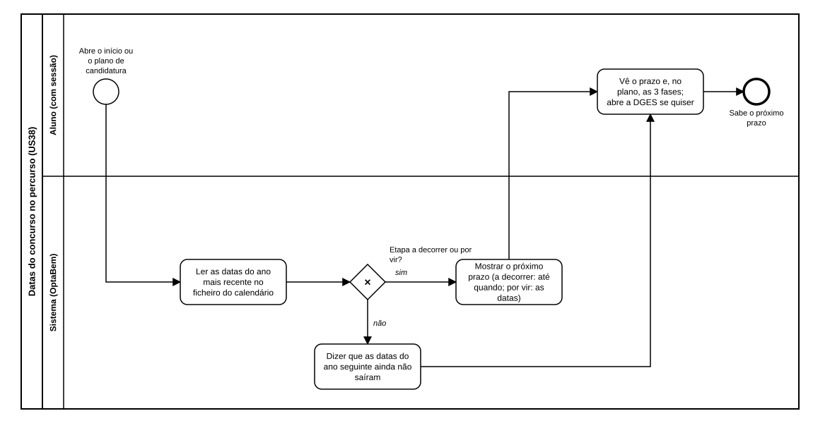

# US38 — Diagrama BPMN: datas do concurso no percurso

O ficheiro editável é [diagramas/bpmn.bpmn](diagramas/bpmn.bpmn) (BPMN 2.0). Abre-se em [demo.bpmn.io](https://demo.bpmn.io) ou no Camunda Modeler. As duas versões são geradas por [diagramas/gerar.py](diagramas/gerar.py).

## Processo

1. O aluno **abre o início ou o plano de candidatura**; o sistema **lê as datas do ano mais recente** no ficheiro do calendário.
2. *Etapa a decorrer ou por vir?* **sim:** o sistema **mostra o próximo prazo** (a decorrer: até quando; por vir: as datas). **não:** **diz que as datas do ano seguinte ainda não saíram**.
3. O aluno **vê o prazo** e, no plano, as 3 fases; abre a DGES se quiser.

## Como o diagrama se liga ao código

| Elemento BPMN | Código |
|---|---|
| Ler as datas do ano mais recente | `calendario.ler(CALENDARIO_CSV)` |
| Etapa a decorrer ou por vir? | `calendario.proximo_prazo(calendario, hoje)` |
| Mostrar o próximo prazo / dizer que as datas ainda não saíram | `calendario.frase_do_prazo`; `templates/home.html`; secção «Datas do concurso nacional» em `templates/candidatura/plano.html` |
