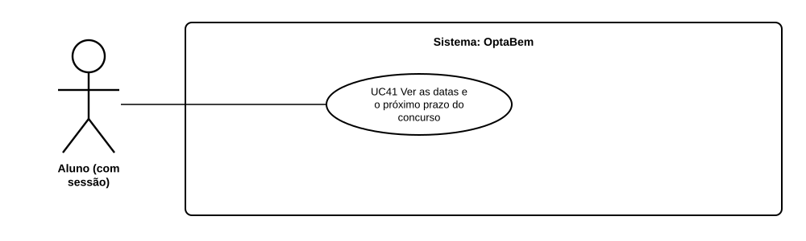

# US38 — Use case: datas do concurso no percurso

## 1. Atores

| Ator | Tipo | Descrição |
|---|---|---|
| Aluno | Primário | Conta de aluno com sessão iniciada. |

## 2. Lista de use cases

| ID | Nome | Relações |
|---|---|---|
| UC41 | Ver as datas e o próximo prazo do concurso | — |

## 3. UC41 — Ver as datas e o próximo prazo do concurso

| | |
|---|---|
| **Objetivo** | Saber o próximo prazo do concurso nacional e as datas das 3 fases. |
| **Pré-condições** | Sessão iniciada. |
| **Requisitos** | RF50.1 a RF50.5 |

**Fluxo principal:** (1) o aluno abre o início; (2) o sistema lê as datas do ano mais recente e mostra o próximo prazo no passo atual; (3) o aluno abre o plano de candidatura e vê as 3 fases, com a etapa a decorrer assinalada; (4) se quiser, abre o calendário oficial na DGES.

**Alternativos:** depois do concurso → o sistema diz que as datas do ano seguinte ainda não saíram. Sem ficheiro de datas → o plano manda para a DGES.

## 4. Rastreabilidade

| Use case | Requisitos | Código | Testes |
|---|---|---|---|
| UC41 | RF50.1 a RF50.5 | `candidatura/calendario.py`, `main.home`, `candidatura/routes.plano` | `tests/test_calendario.py` |
