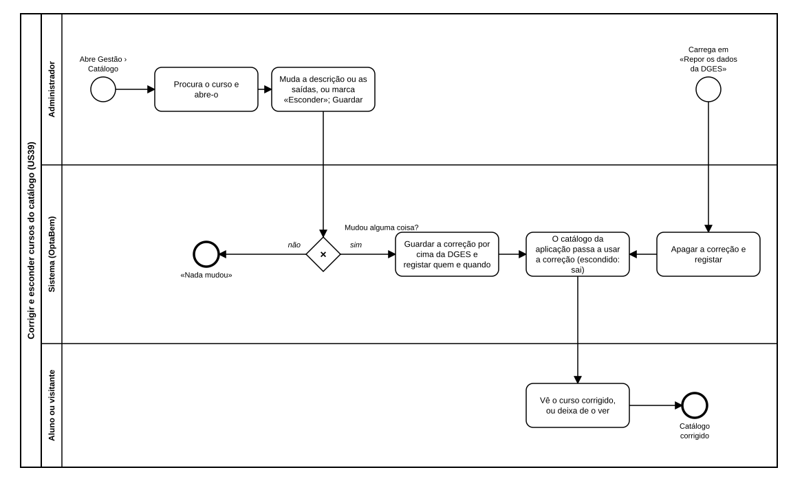

# US39 — Diagrama BPMN: corrigir e esconder cursos do catálogo

O ficheiro editável é [diagramas/bpmn.bpmn](diagramas/bpmn.bpmn) (BPMN 2.0). Abre-se em [demo.bpmn.io](https://demo.bpmn.io) ou no Camunda Modeler. As duas versões são geradas por [diagramas/gerar.py](diagramas/gerar.py).

## Processo

1. O administrador **abre Gestão › Catálogo**, **procura o curso e abre-o**, **muda a descrição ou as saídas, ou marca «Esconder»**, e guarda.
2. *Mudou alguma coisa?* **não:** «Nada mudou». **sim:** o sistema **guarda a correção por cima da DGES e regista quem e quando**.
3. O **catálogo da aplicação passa a usar a correção** (um curso escondido sai); o aluno ou visitante **vê o curso corrigido, ou deixa de o ver**.
4. A qualquer momento, o administrador pode **carregar em «Repor os dados da DGES»**: o sistema **apaga a correção e regista-o**, e o catálogo volta ao texto do ficheiro.

## Como o diagrama se liga ao código

| Elemento BPMN | Código |
|---|---|
| Procura o curso e abre-o | `GET /gestao/cursos` e `GET /gestao/cursos/<chave>` → `gestao/routes.py` |
| Mudou alguma coisa? / Guardar e registar | `POST /gestao/cursos/<chave>` → `gestao/services.guardar_correcao`; `correcoes_repository.guardar`, `registar` |
| O catálogo passa a usar a correção | `catalogo/services.cursos` (`correcoes`, `aplicar_correcoes`) |
| Apagar a correção e registar | `POST /gestao/cursos/<chave>/repor` → `gestao/services.repor_curso` |
