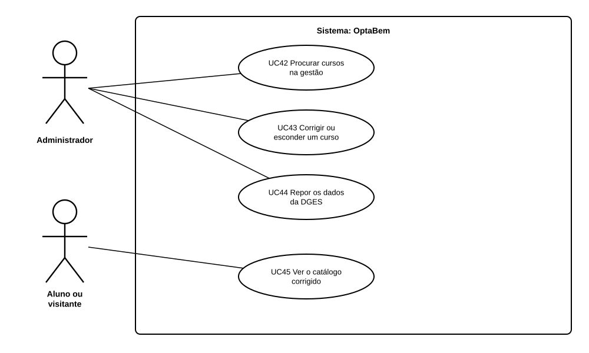

# US39 — Use case: corrigir e esconder cursos do catálogo

## 1. Atores

| Ator | Tipo | Descrição |
|---|---|---|
| Administrador | Primário (UC42 a UC44) | Conta de administrador (US03), com sessão na gestão. |
| Aluno ou visitante | Primário (UC45) | Qualquer pessoa que veja o catálogo, com ou sem sessão. |

## 2. Lista de use cases

| ID | Nome | Relações |
|---|---|---|
| UC42 | Procurar cursos na gestão | — |
| UC43 | Corrigir ou esconder um curso | — |
| UC44 | Repor os dados da DGES | — |
| UC45 | Ver o catálogo corrigido | — |

## 3. UC42 — Procurar cursos na gestão

| | |
|---|---|
| **Objetivo** | Encontrar o curso a corrigir, ou ver os que já foram corrigidos ou escondidos. |
| **Pré-condições** | Sessão de administrador. |
| **Requisitos** | RF51.1 |

**Fluxo principal:** (1) o administrador abre Gestão › Catálogo; (2) escreve o nome do curso ou da instituição e, se quiser, escolhe «corrigidos ou escondidos» ou «escondidos»; (3) o sistema mostra os cursos, com o estado e a última alteração.

## 4. UC43 — Corrigir ou esconder um curso

| | |
|---|---|
| **Objetivo** | Tirar um erro do catálogo sem mexer no ficheiro da DGES. |
| **Pré-condições** | Sessão de administrador; o curso existe no ficheiro da DGES. |
| **Pós-condições** | A correção está guardada e registada; o catálogo da aplicação já a usa. |
| **Requisitos** | RF51.2 a RF51.5 |

**Fluxo principal:** (1) o administrador abre o curso; (2) muda a descrição ou as saídas, ou marca «Esconder este curso»; (3) carrega em «Guardar»; (4) o sistema guarda a correção, regista quem a fez e quando, e mostra «Correção guardada».

**Alternativos:** nada mudou → «Nada mudou», sem registo. Texto demasiado longo → erro no campo, nada guardado.

## 5. UC44 — Repor os dados da DGES

| | |
|---|---|
| **Objetivo** | Desfazer uma correção. |
| **Pré-condições** | O curso tem uma correção. |
| **Requisitos** | RF51.3, RF51.5 |

**Fluxo principal:** (1) na página do curso, o administrador carrega em «Repor os dados da DGES»; (2) o sistema apaga a correção, regista-o e volta a mostrar o texto do ficheiro.

## 6. UC45 — Ver o catálogo corrigido

| | |
|---|---|
| **Objetivo** | Ver o catálogo sem os erros corrigidos na gestão. |
| **Pré-condições** | Nenhuma. |
| **Requisitos** | RF51.4 |

**Fluxo principal:** (1) a pessoa abre a ficha, a pesquisa, a comparação, a conversa ou o plano; (2) o sistema mostra os cursos com as correções e sem os escondidos.

**Alternativos:** uma opção do plano foi escondida → o plano mostra um aviso, com «Retirar».

## 7. Rastreabilidade

| Use case | Requisitos | Código | Testes |
|---|---|---|---|
| UC42 | RF51.1 | `gestao/routes.cursos`, `catalogo.services.cursos_para_gestao` | `SoNaGestaoTests` |
| UC43 | RF51.2, RF51.3, RF51.5 | `gestao/routes.curso_guardar`, `gestao/services.guardar_correcao` | `CorrigirTests`, `EsconderTests`, `RegistoTests` |
| UC44 | RF51.3, RF51.5 | `gestao/routes.curso_repor`, `gestao/services.repor_curso` | `PorCimaDaDgesTests`, `RegistoTests` |
| UC45 | RF51.4 | `catalogo.services.cursos`, `candidatura/routes.plano` | `EsconderTests`, `PorCimaDaDgesTests` |
