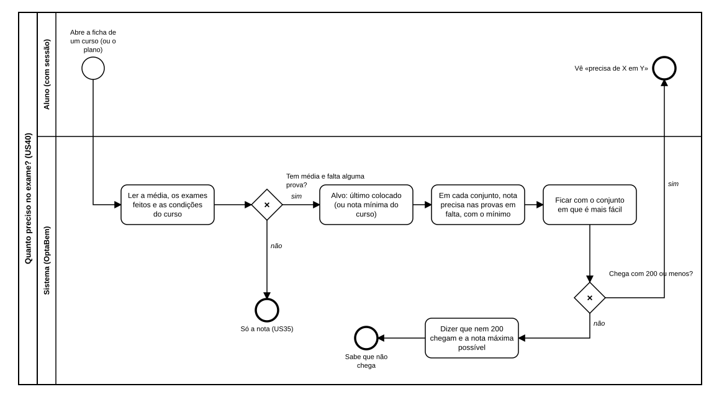

# US40 — Diagrama BPMN: quanto preciso no exame?

O ficheiro editável é [diagramas/bpmn.bpmn](diagramas/bpmn.bpmn) (BPMN 2.0). Abre-se em [demo.bpmn.io](https://demo.bpmn.io) ou no Camunda Modeler. As duas versões são geradas por [diagramas/gerar.py](diagramas/gerar.py).

## Processo

1. O aluno **abre a ficha de um curso** (ou o plano).
2. O sistema **lê a média, os exames feitos e as condições do curso**. *Tem média e falta alguma prova?* **não:** só mostra a nota (US35).
3. **sim:** o alvo é o último colocado (ou a nota mínima); o sistema **calcula, em cada conjunto, a nota precisa nas provas em falta** e **fica com o conjunto mais fácil**.
4. *Chega com 200 ou menos?* **sim:** o aluno vê «precisa de X em Y». **não:** o sistema diz que nem 200 chegam e qual é a nota máxima possível.

## Como o diagrama se liga ao código

| Elemento BPMN | Código |
|---|---|
| Ler a média, os exames e as condições | `catalogo.routes.ficha`; `candidatura.services.opcoes` (no plano) |
| Alvo e nota precisa em cada conjunto | `calculos.nota_necessaria` |
| Ficar com o conjunto mais fácil | comparação `(pontos, provas em falta)` em `nota_necessaria` |
| Chega com 200 ou menos? | `Necessidade.possivel`, `Necessidade.maximo` |
| Mostrar | macro `necessidade`; `texts.CANDIDATURA_PRECISA` no plano |
