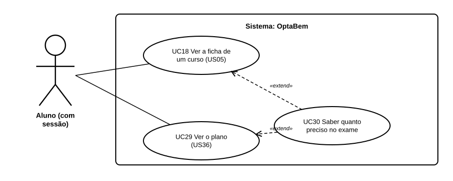

# US40 — Use case: quanto preciso no exame?

## 1. Atores

| Ator | Tipo | Descrição |
|---|---|---|
| Aluno | Primário (UC30) | Conta de aluno com sessão iniciada. |

## 2. Lista de use cases

| ID | Nome | Relações |
|---|---|---|
| UC30 | Saber quanto preciso no exame | estende *UC18 Ver a ficha de um curso* e *UC29 Ver o plano* |

## 3. UC30 — Saber quanto preciso no exame

| | |
|---|---|
| **Objetivo** | Saber que nota tirar nos exames que faltam. |
| **Pré-condições** | Sessão iniciada; média do secundário indicada. |
| **Requisitos** | RF44.1 a RF44.7 |

**Fluxo principal:** (1) o aluno abre a ficha de um curso ou o plano; (2) o sistema lê a média, os exames feitos e as condições do curso; (3) para cada conjunto de provas calcula a nota precisa nas provas em falta, com o mínimo de cada prova; (4) fica com o conjunto mais fácil e mostra «precisa de X pontos em Y».

**Alternativos:** sem média → pede a média; já tem as provas → não há conta (a nota é a da US35); nem 200 chegam → diz a nota máxima possível.
