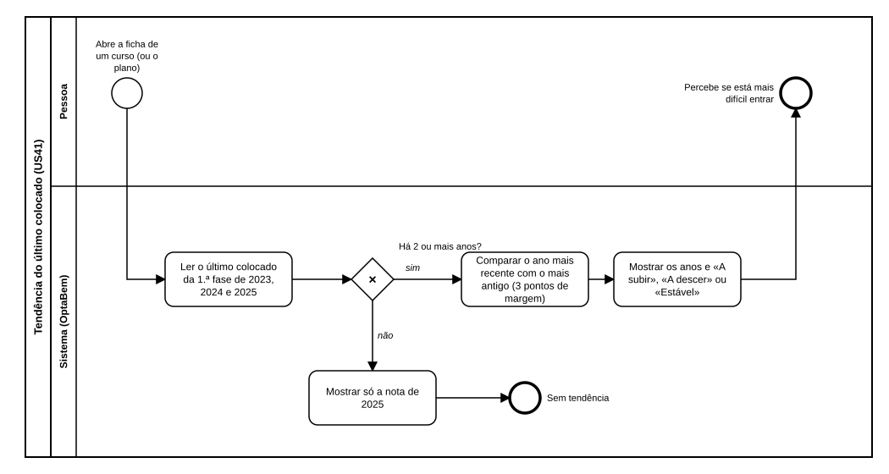

# US41 — Diagrama BPMN: tendência do último colocado

O ficheiro editável é [diagramas/bpmn.bpmn](diagramas/bpmn.bpmn) (BPMN 2.0). Abre-se em [demo.bpmn.io](https://demo.bpmn.io) ou no Camunda Modeler. As duas versões são geradas por [diagramas/gerar.py](diagramas/gerar.py).

## Processo

1. A pessoa **abre a ficha de um curso** (ou o plano).
2. O sistema **lê o último colocado da 1.ª fase de 2023, 2024 e 2025**. *Há 2 ou mais anos?* **não:** mostra só a nota que existe.
3. **sim:** **compara o ano mais recente com o mais antigo** e **mostra os anos e a etiqueta**.

## Como o diagrama se liga ao código

| Elemento BPMN | Código |
|---|---|
| Ler o último colocado de 2023 a 2025 | `Curso.historico` (colunas do CSV escritas por `recolher_dges.py`) |
| Há 2 ou mais anos? / Comparar | `Curso.tendencia` |
| Mostrar | macro `tendencia` em `templates/macros/candidatura.html` |
