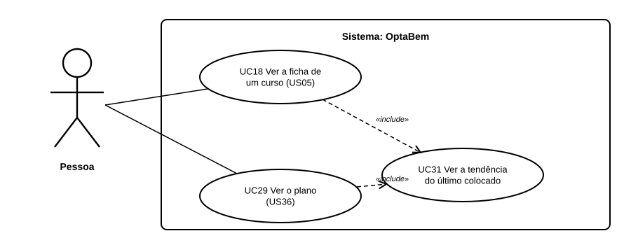

# US41 — Use case: tendência do último colocado

## 1. Atores

| Ator | Tipo | Descrição |
|---|---|---|
| Pessoa | Primário (UC31) | Qualquer pessoa na ficha; o aluno com sessão também no plano. |

## 2. Lista de use cases

| ID | Nome | Relações |
|---|---|---|
| UC31 | Ver a tendência do último colocado | incluído em *UC18 Ver a ficha de um curso* e *UC29 Ver o plano* |

## 3. UC31 — Ver a tendência do último colocado

| | |
|---|---|
| **Objetivo** | Perceber se entrar num curso está a ficar mais difícil. |
| **Pré-condições** | Nenhuma na ficha; sessão iniciada no plano. |
| **Requisitos** | RF45.2 a RF45.5 |

**Fluxo principal:** (1) a pessoa abre a ficha de um curso (ou o plano); (2) o sistema lê o último colocado de 2023 a 2025; (3) compara o ano mais recente com o mais antigo; (4) mostra os anos e a etiqueta.

**Alternativos:** menos de 2 anos com valor → mostra só a nota que existe, sem etiqueta.
