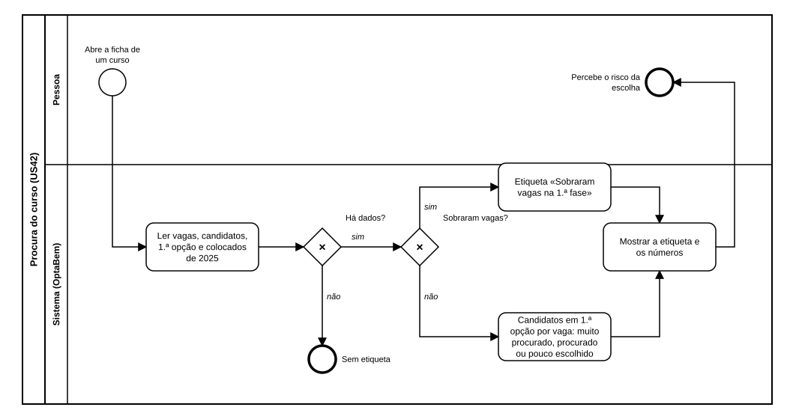

# US42 — Diagrama BPMN: procura do curso

O ficheiro editável é [diagramas/bpmn.bpmn](diagramas/bpmn.bpmn) (BPMN 2.0). Abre-se em [demo.bpmn.io](https://demo.bpmn.io) ou no Camunda Modeler. As duas versões são geradas por [diagramas/gerar.py](diagramas/gerar.py).

## Processo

1. A pessoa **abre a ficha de um curso**.
2. O sistema **lê vagas, candidatos, 1.ª opção e colocados de 2025**. *Há dados?* **não:** sem etiqueta.
3. *Sobraram vagas?* **sim:** «Sobraram vagas na 1.ª fase». **não:** etiqueta pelos candidatos em 1.ª opção por vaga.
4. O sistema **mostra a etiqueta e os números**.

## Como o diagrama se liga ao código

| Elemento BPMN | Código |
|---|---|
| Ler a procura de 2025 | colunas do CSV escritas por `recolher_dges._tendencia_e_procura` |
| Há dados? / Sobraram vagas? / Etiqueta | `Curso.procura` |
| Mostrar | macro `procura` em `templates/macros/candidatura.html` |
