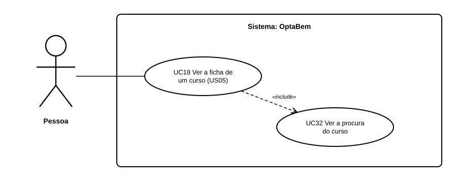

# US42 — Use case: procura do curso

## 1. Atores

| Ator | Tipo | Descrição |
|---|---|---|
| Pessoa | Primário (UC32) | Qualquer pessoa, com ou sem sessão iniciada. |

## 2. Lista de use cases

| ID | Nome | Relações |
|---|---|---|
| UC32 | Ver a procura do curso | incluído em *UC18 Ver a ficha de um curso* |

## 3. UC32 — Ver a procura do curso

| | |
|---|---|
| **Objetivo** | Perceber se um curso é muito disputado. |
| **Pré-condições** | Nenhuma. |
| **Requisitos** | RF46.2 a RF46.4 |

**Fluxo principal:** (1) a pessoa abre a ficha de um curso; (2) o sistema lê a procura de 2025; (3) escolhe a etiqueta; (4) mostra a etiqueta e os números.

**Alternativos:** sem dados → a linha não aparece.
