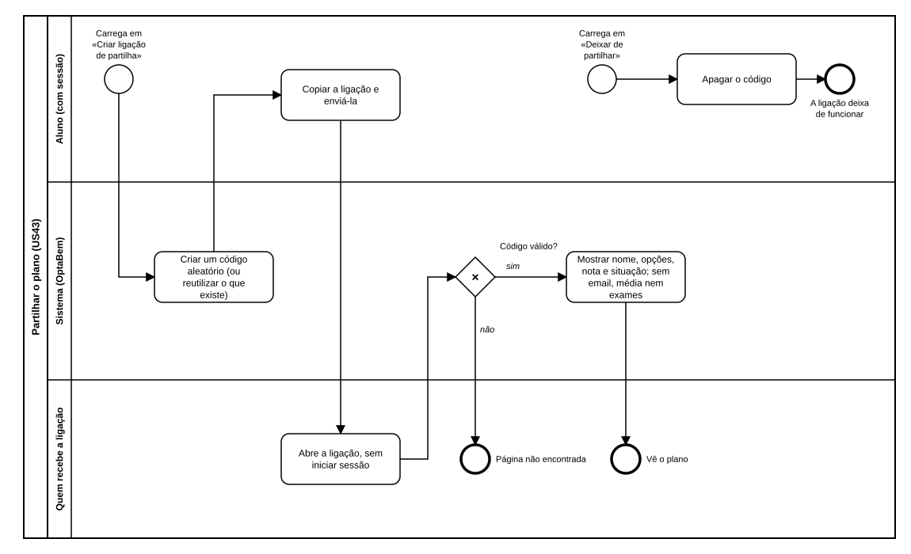

# US43 — Diagrama BPMN: partilhar o plano

O ficheiro editável é [diagramas/bpmn.bpmn](diagramas/bpmn.bpmn) (BPMN 2.0). Abre-se em [demo.bpmn.io](https://demo.bpmn.io) ou no Camunda Modeler. As duas versões são geradas por [diagramas/gerar.py](diagramas/gerar.py).

## Processo

1. O aluno **carrega em «Criar ligação de partilha»**; o sistema **cria um código aleatório** (ou reutiliza o que existe); o aluno **copia a ligação e envia-a**.
2. Quem a recebe **abre a ligação, sem iniciar sessão**. *Código válido?* **sim:** o sistema mostra o nome, as opções, a nota e a situação, sem dados pessoais. **não:** página não encontrada.
3. A qualquer momento, o aluno **carrega em «Deixar de partilhar»**; o sistema **apaga o código** e a ligação deixa de funcionar.

## Como o diagrama se liga ao código

| Elemento BPMN | Código |
|---|---|
| Criar um código aleatório | `services.partilhar` (`secrets.token_urlsafe(16)`), `repository.mudar_partilha` |
| Abre a ligação / Código válido? | `GET /candidatura/p/<codigo>` → `routes.partilhado`; `services.plano_partilhado` |
| Mostrar sem dados pessoais | `templates/candidatura/partilhado.html`; `repository.por_partilha` (só o nome) |
| Apagar o código | `POST /candidatura/deixar-de-partilhar` → `services.deixar_de_partilhar` |
