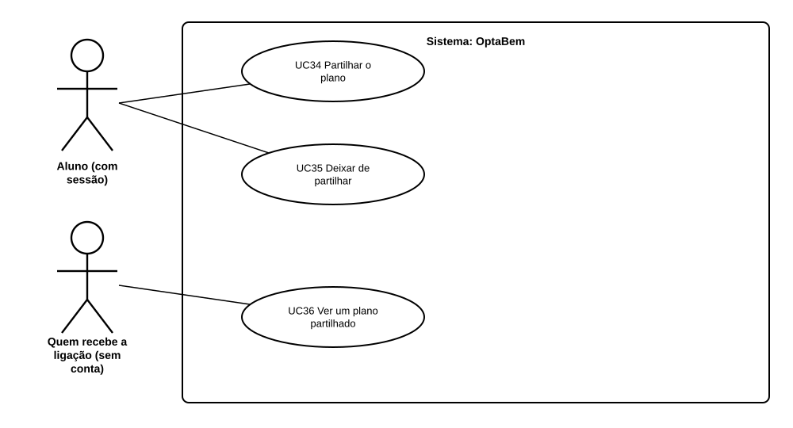

# US43 — Use case: partilhar o plano

## 1. Atores

| Ator | Tipo | Descrição |
|---|---|---|
| Aluno | Primário (UC34, UC35) | Conta de aluno com sessão iniciada. |
| Quem recebe a ligação | Primário (UC36) | Qualquer pessoa, sem conta. |

## 2. Lista de use cases

| ID | Nome | Relações |
|---|---|---|
| UC34 | Partilhar o plano | — |
| UC35 | Deixar de partilhar | — |
| UC36 | Ver um plano partilhado | — |

## 3. UC34 — Partilhar o plano

| | |
|---|---|
| **Objetivo** | Mostrar o plano a quem ajuda a decidir. |
| **Pré-condições** | Sessão iniciada. |
| **Requisitos** | RF47.1, RF47.6 |

**Fluxo principal:** (1) no plano, o aluno carrega em «Criar ligação de partilha»; (2) o sistema cria o código (ou reutiliza o que existe) e mostra a ligação; (3) o aluno copia-a e envia-a.

## 4. UC35 — Deixar de partilhar

| | |
|---|---|
| **Objetivo** | Retirar o acesso a quem tem a ligação. |
| **Pré-condições** | Partilha ligada. |
| **Requisitos** | RF47.4 |

**Fluxo principal:** (1) o aluno carrega em «Deixar de partilhar»; (2) o sistema apaga o código; (3) a ligação deixa de funcionar.

## 5. UC36 — Ver um plano partilhado

| | |
|---|---|
| **Objetivo** | Ver o plano de outra pessoa, só de leitura. |
| **Pré-condições** | Ter a ligação. |
| **Requisitos** | RF47.2, RF47.3, RF47.5 |

**Fluxo principal:** (1) a pessoa abre a ligação, sem sessão; (2) o sistema procura o código; (3) mostra o primeiro nome, as opções, a nota e a situação.

**Alternativos:** código errado ou desligado → página não encontrada (404).
