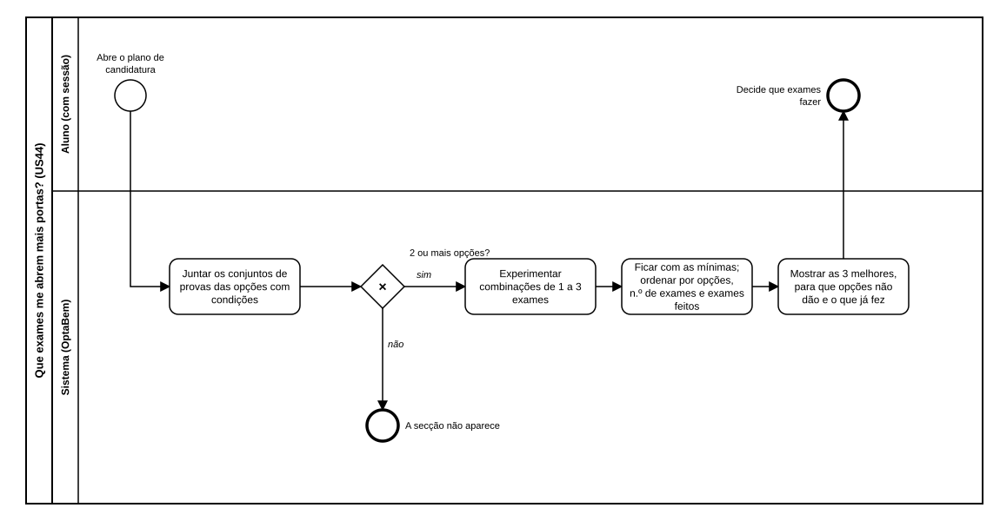

# US44 — Diagrama BPMN: que exames me abrem mais portas?

O ficheiro editável é [diagramas/bpmn.bpmn](diagramas/bpmn.bpmn) (BPMN 2.0). Abre-se em [demo.bpmn.io](https://demo.bpmn.io) ou no Camunda Modeler. As duas versões são geradas por [diagramas/gerar.py](diagramas/gerar.py).

## Processo

1. O aluno **abre o plano de candidatura**.
2. O sistema **junta os conjuntos de provas das opções**. *2 ou mais opções?* **não:** a secção não aparece.
3. **sim:** **experimenta combinações de 1 a 3 exames**, **fica com as mínimas e ordena-as** e **mostra as 3 melhores**; o aluno decide que exames fazer.

## Como o diagrama se liga ao código

| Elemento BPMN | Código |
|---|---|
| Juntar os conjuntos / 2 ou mais opções? | `calculos.exames_que_abrem_portas` (início) |
| Experimentar combinações | `itertools.combinations`, `MAX_EXAMES` |
| Ficar com as mínimas e ordenar | lista `minimas` e ordenação em `exames_que_abrem_portas` |
| Mostrar | `services.exames_do_plano`; `templates/candidatura/plano.html` |
