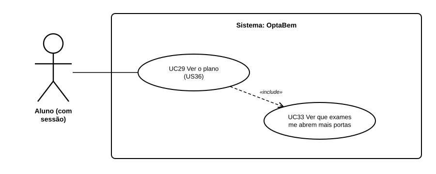

# US44 — Use case: que exames me abrem mais portas?

## 1. Atores

| Ator | Tipo | Descrição |
|---|---|---|
| Aluno | Primário (UC33) | Conta de aluno com sessão iniciada. |

## 2. Lista de use cases

| ID | Nome | Relações |
|---|---|---|
| UC33 | Ver que exames me abrem mais portas | incluído em *UC29 Ver o plano* |

## 3. UC33 — Ver que exames me abrem mais portas

| | |
|---|---|
| **Objetivo** | Decidir que exames nacionais fazer. |
| **Pré-condições** | Sessão iniciada; 2 ou mais opções com condições de acesso. |
| **Requisitos** | RF48.1 a RF48.6 |

**Fluxo principal:** (1) o aluno abre o plano; (2) o sistema junta os conjuntos de provas das opções; (3) experimenta combinações de 1 a 3 exames e ordena-as; (4) mostra as 3 melhores.

**Alternativos:** menos de 2 opções com condições → a secção não aparece.
