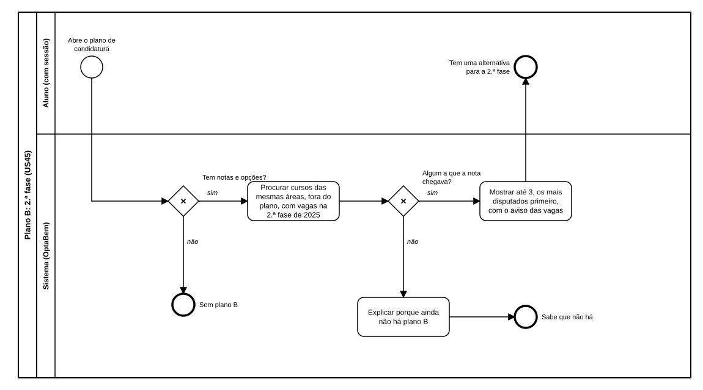

# US45 — Diagrama BPMN: plano B: 2.ª fase

O ficheiro editável é [diagramas/bpmn.bpmn](diagramas/bpmn.bpmn) (BPMN 2.0). Abre-se em [demo.bpmn.io](https://demo.bpmn.io) ou no Camunda Modeler. As duas versões são geradas por [diagramas/gerar.py](diagramas/gerar.py).

## Processo

1. O aluno **abre o plano**. *Tem notas e opções?* **não:** sem plano B.
2. **sim:** o sistema **procura cursos das mesmas áreas, fora do plano, com vagas na 2.ª fase de 2025**. *Algum a que a nota chegava?*
3. **sim:** **mostra até 3, os mais disputados primeiro, com o aviso das vagas**. **não:** **explica porque ainda não há plano B**.

## Como o diagrama se liga ao código

| Elemento BPMN | Código |
|---|---|
| Tem notas e opções? | `services.plano_b` (início) |
| Procurar cursos das mesmas áreas | ciclo em `services.plano_b` |
| A nota chegava? | `calculos.chega_na_2a_fase` |
| Mostrar / Explicar | `templates/candidatura/plano.html`; `texts.PLANO_B_*` |
