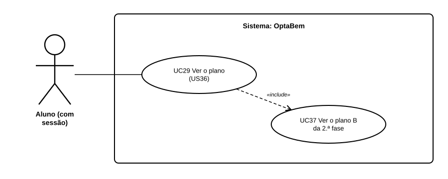

# US45 — Use case: plano B: 2.ª fase

## 1. Atores

| Ator | Tipo | Descrição |
|---|---|---|
| Aluno | Primário (UC37) | Conta de aluno com sessão iniciada. |

## 2. Lista de use cases

| ID | Nome | Relações |
|---|---|---|
| UC37 | Ver o plano B da 2.ª fase | incluído em *UC29 Ver o plano* |

## 3. UC37 — Ver o plano B da 2.ª fase

| | |
|---|---|
| **Objetivo** | Ter uma alternativa se não entrar na 1.ª fase. |
| **Pré-condições** | Sessão iniciada; notas e pelo menos uma opção. |
| **Requisitos** | RF49.2 a RF49.6 |

**Fluxo principal:** (1) o aluno abre o plano; (2) o sistema procura cursos das mesmas áreas, fora do plano, com vagas na 2.ª fase de 2025; (3) fica com os que a nota alcançava; (4) mostra até 3, com o aviso.

**Alternativos:** sem notas ou sem opções → a secção não aparece; nenhum curso → explica porque ainda não há plano B.
