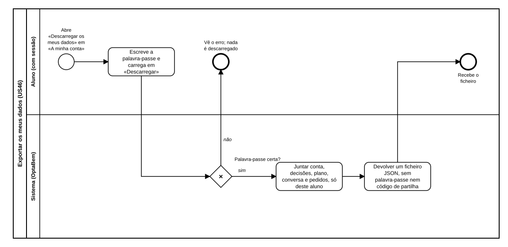

# US46 — Diagrama BPMN: exportar os meus dados

O ficheiro editável é [diagramas/bpmn.bpmn](diagramas/bpmn.bpmn) (BPMN 2.0). Abre-se em [demo.bpmn.io](https://demo.bpmn.io) ou no Camunda Modeler. As duas versões são geradas por [diagramas/gerar.py](diagramas/gerar.py).

## Processo

1. O aluno **abre «Descarregar os meus dados»** em «A minha conta» e **escreve a palavra-passe**.
2. *Palavra-passe certa?* **não:** o aluno vê o erro e nada é descarregado. **sim:** o sistema **junta a conta, as decisões, o plano, a conversa e os pedidos**, só deste aluno.
3. O sistema **devolve um ficheiro JSON**, sem palavra-passe nem código de partilha, e o aluno **recebe o ficheiro**.

## Como o diagrama se liga ao código

| Elemento BPMN | Código |
|---|---|
| Escreve a palavra-passe | `templates/auth/exportar.html` |
| Palavra-passe certa? | `POST /auth/conta/exportar` → `routes.export_submit`; `services.confirma_password` |
| Juntar os dados do aluno | `exportar.dados_do_utilizador` (lê pelo `user_id` da sessão) |
| Devolver um ficheiro JSON | `routes.export_submit` (`Content-Disposition: attachment`, `Cache-Control: no-store`) |
