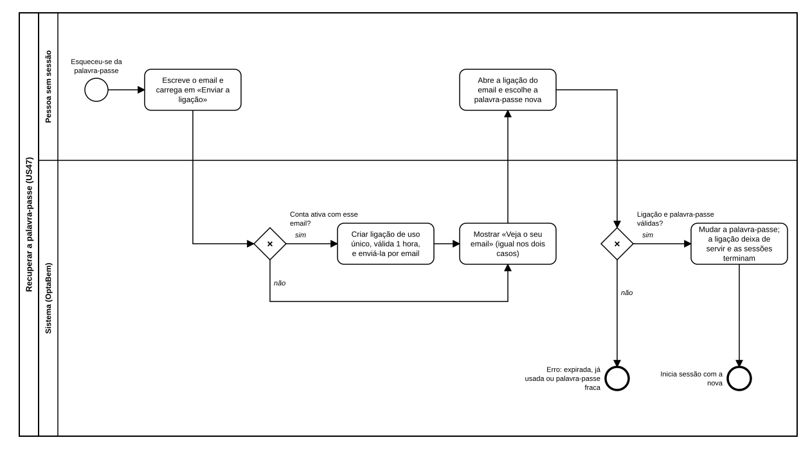

# US47 — Diagrama BPMN: recuperar a palavra-passe

O ficheiro editável é [diagramas/bpmn.bpmn](diagramas/bpmn.bpmn) (BPMN 2.0). Abre-se em [demo.bpmn.io](https://demo.bpmn.io) ou no Camunda Modeler. As duas versões são geradas por [diagramas/gerar.py](diagramas/gerar.py).

## Processo

1. A pessoa **escreve o email** e carrega em «Enviar a ligação».
2. *Conta ativa com esse email?* **sim:** o sistema **cria uma ligação de uso único, válida 1 hora, e envia-a por email**. **não:** não envia nada. Nos dois casos, **mostra «Veja o seu email»**.
3. A pessoa **abre a ligação do email e escolhe a palavra-passe nova**.
4. *Ligação e palavra-passe válidas?* **sim:** o sistema **muda a palavra-passe**; a ligação deixa de servir e as sessões terminam; a pessoa inicia sessão com a nova. **não:** erro (ligação expirada ou já usada, ou palavra-passe fora das regras).

## Como o diagrama se liga ao código

| Elemento BPMN | Código |
|---|---|
| Escreve o email | `templates/auth/recuperar.html`; `POST /auth/recuperar` → `routes.recovery_submit` |
| Conta ativa com esse email? | `services.pedir_recuperacao` (devolve `None` sem conta ativa) |
| Criar a ligação e enviá-la | `tokens.make_reset_token`, `tokens.impressao_da_password`; `routes._recovery_message` e o `mailer` |
| Mostrar «Veja o seu email» | `GET /auth/recuperar/enviado` → `templates/auth/recuperar_enviado.html` |
| Ligação e palavra-passe válidas? | `services.recuperar_password` (`_ler_token_de_recuperacao`, `password_errors`) |
| Mudar a palavra-passe; as sessões terminam | `repository.update_password`; `sessions.load_current_user` compara a impressão |
