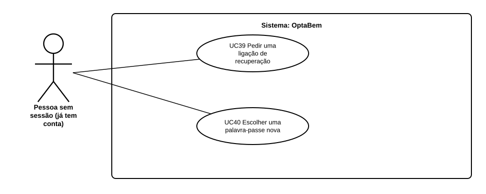

# US47 — Use case: recuperar a palavra-passe

## 1. Atores

| Ator | Tipo | Descrição |
|---|---|---|
| Pessoa sem sessão | Primário | Tem conta (ativa) mas esqueceu-se da palavra-passe. Recebe a ligação no email da conta. |

## 2. Lista de use cases

| ID | Nome | Relações |
|---|---|---|
| UC39 | Pedir uma ligação de recuperação | — |
| UC40 | Escolher uma palavra-passe nova | — |

## 3. UC39 — Pedir uma ligação de recuperação

| | |
|---|---|
| **Objetivo** | Receber, no email da conta, uma ligação para escolher uma palavra-passe nova. |
| **Pré-condições** | Sem sessão (ou com sessão: a página funciona na mesma). |
| **Requisitos** | RF02.11, RF02.12, RF02.13 |

**Fluxo principal:** (1) no início de sessão, a pessoa carrega em «Esqueceu-se da palavra-passe?»; (2) escreve o email e carrega em «Enviar a ligação»; (3) se houver uma conta ativa com esse email, o sistema cria a ligação e envia-a; (4) o sistema mostra «Veja o seu email».

**Alternativos:** email mal escrito → mensagem de erro (volta ao passo 2). Sem conta ativa, ou falha no envio → o passo 4 é igual, sem email.

## 4. UC40 — Escolher uma palavra-passe nova

| | |
|---|---|
| **Objetivo** | Voltar a entrar na conta com uma palavra-passe nova. |
| **Pré-condições** | Ter uma ligação de recuperação com menos de 1 hora e ainda não usada. |
| **Pós-condições** | A palavra-passe mudou; a ligação deixou de servir; as sessões abertas da conta terminaram. |
| **Requisitos** | RF02.13 a RF02.16 |

**Fluxo principal:** (1) a pessoa abre a ligação do email; (2) escreve a palavra-passe nova duas vezes; (3) o sistema muda-a e leva a pessoa ao início de sessão.

**Alternativos:** ligação expirada, já usada ou adulterada → página de erro com «Pedir outra ligação». Palavra-passe fora das regras → erro no campo (volta ao passo 2; a ligação continua a servir).

## 5. Rastreabilidade

| Use case | Requisitos | Código | Testes |
|---|---|---|---|
| UC39 | RF02.11 a RF02.13 | `routes.recovery_form`, `routes.recovery_submit`, `services.pedir_recuperacao` | `PedidoTests` |
| UC40 | RF02.13 a RF02.16 | `routes.recovery_reset_form`, `routes.recovery_reset_submit`, `services.recuperar_password`, `sessions.load_current_user` | `LigacaoTests`, `SessoesTests` |
