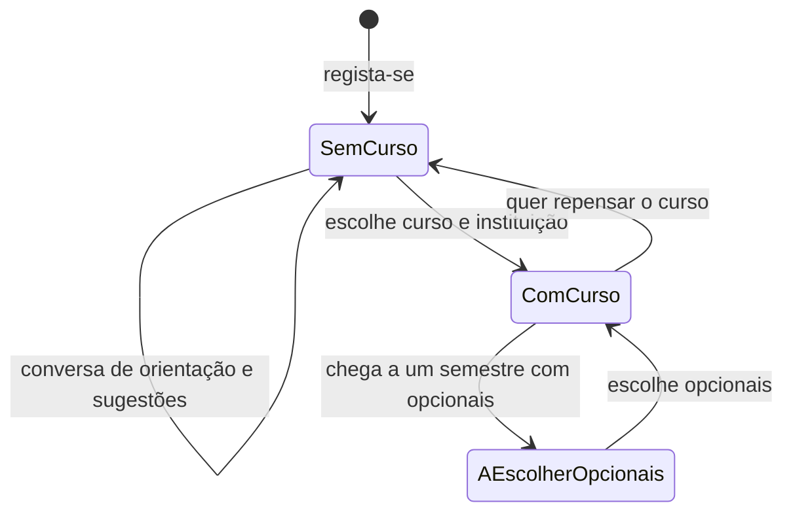

# Visão do produto — OptaBem

Projeto 1 · Metodologias Ágeis (Scrum) · Duarte Eusébio e Simão Almeida

**Versão 1.1 · decisão dos Product Owners · 2026-10-14** (1.0 de 13/10; 1.1: o LLM conduz a conversa de orientação, sem perguntas fixas). Substitui a visão implícita até ao Sprint 1 («recomendador de opcionais para alunos de um curso»). As consequências nos requisitos estão na versão 1.4 de [01-requisitos-funcionais-e-nao-funcionais.md](01-requisitos-funcionais-e-nao-funcionais.md) e no [backlog](product-backlog.xlsx).

## 1. O problema

Escolher um percurso no ensino superior é uma sequência de decisões difíceis, tomadas com pouca informação:

1. **Antes de entrar**, quem está indeciso tem de escolher entre centenas de cursos em dezenas de instituições. A informação oficial (vagas, notas, provas) está espalhada e quase nunca diz *se o curso combina com a pessoa*.
2. **Depois de entrar**, o aluno escolhe opcionais com base em boatos e descrições genéricas, sem saber o que colegas parecidos com ele acharam.

## 2. Para quem é

| Público | Situação | Pergunta que traz ao OptaBem |
|---|---|---|
| **Indeciso** | Ainda não tem curso (pode estar no secundário, a mudar de área ou a regressar aos estudos) | «Que curso, e em que instituição, faz sentido para mim?» |
| **Aluno** | Já frequenta um curso de uma instituição do catálogo | «Que opcionais devo escolher?» |

O mesmo utilizador pode passar de um público para o outro: um indeciso escolhe um curso e, a partir daí, é aluno desse curso.

## 3. Visão

> Para quem tem de decidir o seu percurso no ensino superior, o **OptaBem** é uma aplicação web que sugere cursos e opcionais com explicação, a partir das preferências da pessoa e da experiência de outros estudantes. Ao contrário dos guias oficiais, que listam a oferta, o OptaBem acompanha cada decisão e diz porque é que uma opção lhe pode servir.

## 4. O percurso como sequência de decisões

O OptaBem não atribui um percurso de uma vez: acompanha cada momento de decisão, e cada decisão fica registada (data, opções sugeridas, opção escolhida).

| Momento | O que o OptaBem faz | Como decide |
|---|---|---|
| Escolher curso | Conversa em que o assistente faz perguntas sobre os interesses da pessoa (no máximo 6) e termina com 2 a 3 cursos sugeridos, cada um com explicação | Modelo de linguagem (LLM) que conduz a conversa e sugere só cursos de uma lista fechada do catálogo |
| Comparar cursos | Fichas lado a lado: descrição, saídas, vagas, nota do último colocado | Dados oficiais da DGES e das instituições |
| Preparar a candidatura (desde 23/10) | Condições de acesso de cada curso, a nota de candidatura da pessoa em cada um e a lista das 6 opções, com avisos | Regras e dados oficiais da DGES (contingente geral, 1.ª fase); estimativa, não garantia |
| Escolher opcionais (fase 2, fora da release de 05/11) | Opcionais sugeridas com explicação | Popularidade e, mais tarde, colegas com gostos parecidos |
| Repensar | Nova conversa de orientação; as decisões anteriores ficam na linha do tempo | Igual a «Escolher curso» |

**Decisão dos Product Owners (22/10/2026):** até à entrega de 05/11, o centro do produto são os cursos. O site deixa de falar de opcionais; as opcionais ficam para uma fase seguinte.

**Decisão do PO (23/10/2026, por confirmar com o docente):** depois da escolha do curso, o percurso continua com o **plano de candidatura** ao Concurso Nacional de Acesso, que substitui as opcionais nesta release (no ensino superior português a escolha de opcionais pesa pouco; a candidatura é a decisão real de quem está a escolher curso). As opcionais passam a fase 2.

**O utilizador decide sempre.** O OptaBem sugere e explica; nunca atribui um curso ou uma opcional sem confirmação.

## 5. Âmbito desta release (MVP)

**Dentro:**

- Catálogo de **12 instituições e 30 licenciaturas** em três áreas (Ciência da Informação, Gestão, Informática), públicas e privadas, universidades e politécnicos: ver [`dados/catalogo-cursos-mvp.csv`](../../dados/catalogo-cursos-mvp.csv).
- Consulta e comparação de cursos.
- Conversa de orientação conduzida por um LLM e sugestão de 2 a 3 cursos do catálogo.
- Escolha de curso e linha do tempo das decisões.
- Para quem já é aluno: percurso e avaliação de opcionais (pseudonimizada). As recomendações por popularidade (US11) passaram para o backlog a 14/10, para o plano caber na velocidade real (10 SP por sprint).

**Fora (backlog):** recomendação colaborativa (user-based e por itens), avaliação offline do motor, comentários, horários, mais instituições e áreas.

**Porque 12 instituições:** é o mínimo para haver comparação real dentro de cada área. A lista oficial vem da DGES; as descrições e os planos de estudos vêm do site de cada instituição, o que torna inviável cobrir «todas» nesta release.

## 6. Como sabemos que resulta

| Objetivo | Indicador | Meta para a demonstração |
|---|---|---|
| Sugestões de curso pertinentes | % de sugestões que o utilizador considera «faz sentido» | ≥ 70 % num teste com 10 pessoas |
| Sugestões fiáveis | Sugestões com cursos fora do catálogo que chegam ao ecrã | 0 (validação obrigatória, RN09) |
| Decisões acompanhadas | Utilizadores que escolhem um curso depois de receberem sugestões | ≥ 50 % no mesmo teste |
| Rapidez | Tempo da primeira pergunta à sugestão (até 6 perguntas) | < 4 minutos (proposta de 14/10; era 2 minutos com o questionário fixo) |

*As metas são uma proposta inicial; os Product Owners validam-nas na Sprint Review.*

## 7. Restrições e princípios

- **Privacidade:** ao LLM só seguem o texto da conversa (sem emails nem números longos, que são apagados antes de enviar) e o catálogo, nunca email, nome ou identificadores da conta (RNF12). Fornecedor, limites e termos: [05-spike-llm.md](05-spike-llm.md).
- **Independência do fornecedor:** o LLM fica atrás de uma interface própria; mudar de fornecedor, ou correr um modelo local, não mexe no resto da aplicação. Ver [03-arquitetura-e-padroes.md](03-arquitetura-e-padroes.md).
- **Testável sem rede:** os testes usam um LLM falso de resposta conhecida (RNF06).
- **Sugestão do professor:** o uso de um LLM e de design patterns foi sugerido pelo docente da UC.

## 8. Decisões que deram origem a esta visão

| Data | Decisão | Quem |
|---|---|---|
| 2026-10-07 | Registo com email pessoal: o OptaBem não é exclusivo de uma instituição | Product Owners |
| 2026-10-13 | O utilizador pode ainda não ter curso; o OptaBem orienta também a escolha do curso | Product Owners |
| 2026-10-13 | Várias instituições (MVP com 12) para haver dados comparativos | Product Owners |
| 2026-10-13 | O percurso é atualizado em cada momento de decisão, não atribuído de uma vez | Product Owners |
| 2026-10-13 | LLM para sugerir cursos e design patterns na arquitetura, por sugestão do docente | Product Owners |
| 2026-10-14 | Sem perguntas fixas: o LLM conduz a conversa e associa as respostas a cursos do catálogo (issue #15). Fornecedor: Google Gemini (plano gratuito), Groq como reserva | Product Owner (Duarte Eusébio) |
