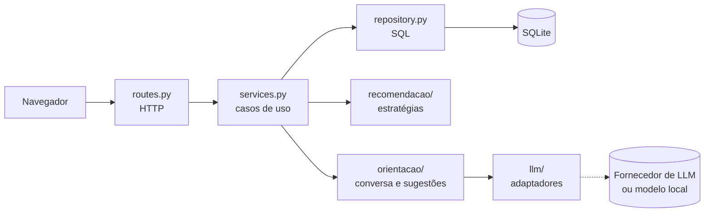
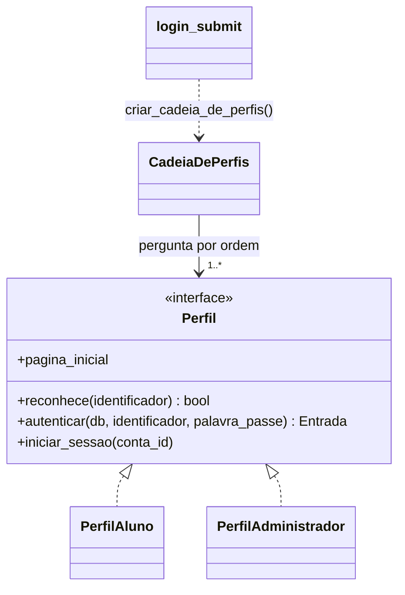
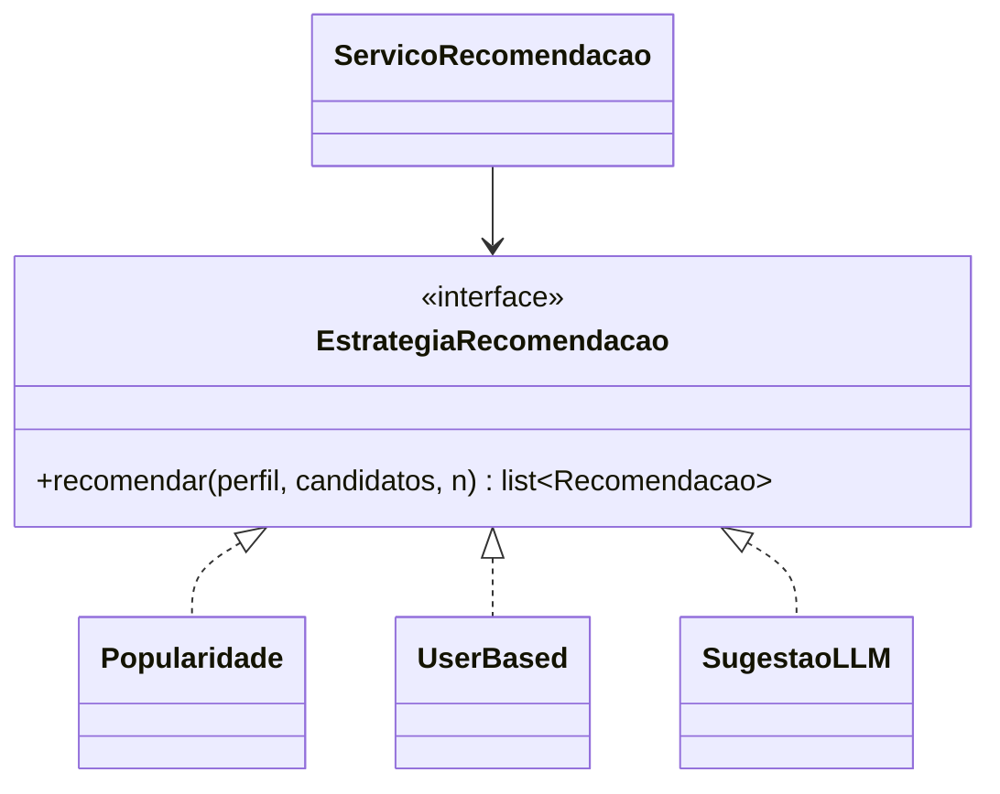
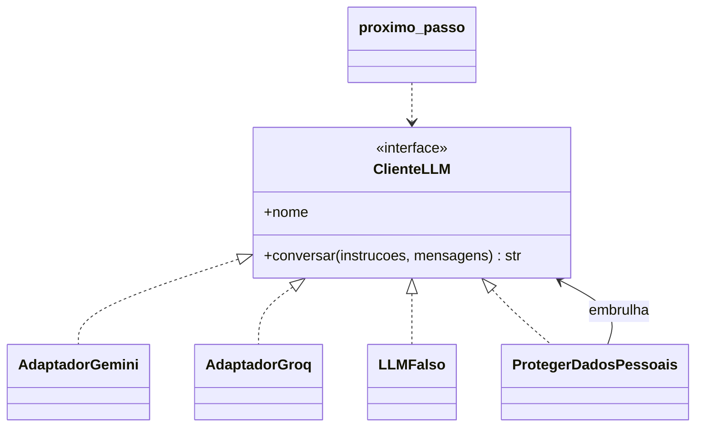

# Arquitetura e padrões de desenho

Projeto 1 · Metodologias Ágeis (Scrum) · OptaBem

**Versão 1.2 · 2026-10-14** (1.0 de 13/10: proposta inicial; 1.1: início de sessão único com Strategy, Chain of Responsibility e Factory; 1.2: spike do LLM — Gemini e Groq, conversa em vez de pedido único, ver [05-spike-llm.md](05-spike-llm.md)). Complementa as regras de [02-regras-de-geracao-de-codigo.md](02-regras-de-geracao-de-codigo.md): aquele documento diz *como* se escreve código; este diz *como as peças se organizam e porquê*. A visão que motiva as partes novas está em [00-visao-do-produto.md](00-visao-do-produto.md).

## 1. Visão geral



`llm/` e a lógica de `orientacao/` existem desde o spike de 14/10 (sem páginas: entram com a US29). `recomendacao/` entra com a US11.

## 2. Tecnologias

| Tema | Escolha | Porquê |
|---|---|---|
| Linguagem | Python 3.10+ | Conhecida pelos dois elementos; boas bibliotecas de dados para o motor |
| Framework web | Flask 3.x | Pequeno e explícito: cada pedido é uma função visível, o que facilita rever código gerado com IA |
| Base de dados | SQLite (`sqlite3` da biblioteca padrão) | Um ficheiro, sem servidor para instalar; suficiente para o volume do projeto |
| Testes | `unittest` | Biblioteca padrão; corre com um único comando e sem rede |
| Motor de recomendação | `pandas` e `numpy` (a partir da US11) | Cálculos de médias e similaridades sobre matrizes |
| LLM | Google Gemini (Flash-Lite, plano gratuito) e Groq como reserva, atrás de uma interface própria (secção 4.2); pedidos com `urllib`, sem SDK | Não ficar preso a um fornecedor; testes sem rede nem custos. Limites, custo e termos em [05-spike-llm.md](05-spike-llm.md) |
| Interface | HTML (Jinja), CSS e JavaScript próprios, sem React nem Tailwind | Componentes de bibliotecas React (ex.: FlowButton, HandwritingText) são **adaptados** a este formato em vez de mudar o projeto para React: a política de segurança (CSP) só aceita ficheiros do próprio site e o código fica legível para os dois elementos |
| Letras «escritas à mão» | `fontTools` no servidor (`app/manuscrito.py`) | Converte as letras em traços SVG sem carregar bibliotecas de outros sites; sem ele, a página mostra texto normal |

## 3. Padrões que o código já usa

Estes padrões existem desde o Sprint 1. Documentá-los ajuda a manter o código coerente quando a IA gera partes novas.

| Padrão | Onde | O que resolve |
|---|---|---|
| **Arquitetura em camadas** | `routes.py` → `services.py` → `repository.py` em cada pacote (`auth/`, `gestao/`) | Cada camada tem uma responsabilidade: as rotas não têm regras, os serviços não conhecem `request`, os repositórios não decidem |
| **Repository** | `app/auth/repository.py`, `app/gestao/repository.py` | Todo o SQL num só sítio; o resto do código não depende da base de dados |
| **Application Factory** | `create_app()` em `app/__init__.py` | Cada teste cria uma aplicação limpa, com a sua própria configuração e base de dados |
| **Decorator** | `login_required` (`app/auth/sessions.py`), `admin_required` (`app/gestao/sessions.py`) | Proteger páginas sem repetir a verificação em cada rota |
| **Strategy + Factory** | `Mailer` (interface), `ConsoleMailer`, `SmtpMailer` e `create_mailer()` em `app/mailer.py` | Mudar a forma de enviar emails só com uma variável (`MAIL_BACKEND`), sem tocar no registo. **É o modelo a seguir para o LLM.** |
| **Strategy** | `PerfilAluno` e `PerfilAdministrador` em `app/auth/perfis.py` | Cada perfil sabe reconhecer quem é dele, verificar a palavra-passe na sua tabela, abrir a sua sessão e para onde vai depois de entrar. A rota de início de sessão não conhece os perfis |
| **Chain of Responsibility** | `CadeiaDePerfis` em `app/auth/perfis.py` | Um só início de sessão para alunos e administradores: o pedido passa pelos perfis até um dizer «é comigo» (email → aluno; nome sem «@» → administrador). Um perfil novo entra na cadeia sem mexer nos outros |
| **Factory** | `criar_cadeia_de_perfis()` em `app/auth/perfis.py` | Monta a cadeia (que perfis existem e por que ordem) num só sítio |
| **Repository** | `app/catalogo/repository.py` | Por agora lê o catálogo do CSV da DGES; na US04 passa a ler da base de dados sem mudar `services.py` nem as páginas |

### 3.1 Um só início de sessão (US03, revisão de 14/10/2026)

Antes, a gestão tinha uma página de entrada própria (`/gestao/entrar`). Agora todos entram em `/auth/entrar` e a aplicação decide o perfil. As contas continuam em tabelas separadas e a gestão continua sem ligações nas páginas dos alunos.



```python
entrada = criar_cadeia_de_perfis().entrar(db, identificador, palavra_passe)
if entrada.outcome is LoginOutcome.SUCCESS:
    entrada.perfil.iniciar_sessao(entrada.conta_id)
    return redirect(url_for(entrada.perfil.pagina_inicial))
```

Testes: `tests/test_perfis.py` testa cada padrão isoladamente (incluindo um perfil falso, para mostrar que a cadeia aceita qualquer perfil com a mesma interface); `tests/test_gestao.py` testa o comportamento.

## 4. Padrões para as funcionalidades novas

### 4.1 Strategy — estratégias de recomendação (US11; depois US12, US22)

Várias formas de recomendar, com a mesma interface. O serviço não sabe qual está a usar.



```python
class EstrategiaRecomendacao(Protocol):
    nome: str
    def recomendar(self, perfil: Perfil, candidatos: list[Item], n: int) -> list[Recomendacao]: ...
```

Cada `Recomendacao` traz o item, uma pontuação e a explicação (US14). Ganhos: a US22 (comparar estratégias) e a US15 (avaliação offline) correm todas as estratégias pela mesma interface; acrescentar uma estratégia não mexe nas outras (RNF07).

### 4.2 Adapter — ligação ao LLM (spike de 14/10; US29, US30)

A aplicação fala com uma interface sua. Cada adaptador traduz para um fornecedor concreto. Como o LLM não se lembra de nada entre pedidos e quem conduz a conversa é ele, cada pedido leva a conversa toda: por isso a interface recebe uma lista de mensagens, e não uma só (versão 1.1 deste documento).



- `AdaptadorGemini`: Google Gemini (`generateContent`); chave `GEMINI_API_KEY` no `.env`, nunca no repositório, sempre num cabeçalho e nunca no endereço.
- `AdaptadorGroq`: Groq (API compatível com a da OpenAI), reserva; chave `GROQ_API_KEY`.
- `LLMFalso`: devolve respostas fixas e guarda o que recebeu; é o que os testes usam (RNF06: sem rede).

Código: `app/llm/` (`cliente.py`, `adaptadores.py`, `decoradores.py`, `fabrica.py`). Testes: `tests/test_llm.py`.

### 4.3 Factory — escolher a implementação pela configuração

Igual ao `create_mailer()`: uma função lê a configuração e devolve a implementação certa.

| Variável | Valores | Por omissão |
|---|---|---|
| `LLM_BACKEND` | `falso`, `gemini`, `groq` | `falso` |
| `LLM_MODELO` | nome do modelo do fornecedor | `gemini-3.5-flash-lite` (Gemini), `openai/gpt-oss-120b` (Groq) |
| `ESTRATEGIA_RECOMENDACAO` | `popularidade`, `user_based` | `popularidade` |

Com `falso` por omissão, quem clona o projeto consegue correr tudo sem chaves nem custos.

### 4.4 Decorator — validar, registar e guardar em cache (US30, US31)

Comportamentos que envolvem o LLM sem alterar os adaptadores:

| Decorator | Faz |
|---|---|
| `ProtegerDadosPessoais` (feito no spike) | Apaga emails e números longos do que o utilizador escreve antes de cada envio (RNF12). A fábrica embrulha sempre o cliente com ele |
| `ValidarContraCatalogo` (feito no spike, como função) | Descarta cursos que não estão no catálogo (RN09). Ficou como a função `validar_contra_catalogo` em `app/orientacao/conversa.py`, e não como decorator do `ClienteLLM`: o cliente devolve texto, e a validação precisa da resposta já lida e do catálogo |
| `RegistarSugestao` | Grava a sugestão (respostas, cursos sugeridos, data) para a linha do tempo do percurso (US31) |
| `CacheRespostas` | Respostas iguais ao mesmo catálogo devolvem a sugestão guardada, sem nova chamada |

A validação é obrigatória e fica sempre entre o LLM e o ecrã.

### 4.5 Chain of Responsibility — filtros antes de recomendar (US13, US20)

Cada filtro recebe a lista de candidatos e devolve-a reduzida: área, instituição, já concluída (RN03), curso e ano, semestre e ECTS. Acrescentar um filtro não obriga a mudar os outros, e cada um testa-se isoladamente.

### 4.6 State — o percurso do utilizador (US31)

O utilizador está num de três estados (sem curso, com curso, a escolher opcionais; ver o diagrama em [00-visao-do-produto.md](00-visao-do-produto.md#4-o-percurso-como-sequência-de-decisões)). Cada estado define o que a página inicial mostra e que transições são permitidas. Na prática, começa por uma função que decide a página; só vale a pena criar classes por estado se as regras crescerem.

**Como está feito (US31, 20/10):** o estado não é guardado numa coluna; é calculado. `estado_do_utilizador` em `app/percurso/__init__.py` olha para o que já existe: uma decisão de curso (tabela `decisoes`) → «com curso»; uma conversa terminada com 2 ou mais cursos → «a escolher curso»; senão → «sem curso». Assim não há um estado guardado que possa ficar desatualizado. As decisões ficam no mesmo pacote, com as camadas de sempre (`routes.py` → `services.py` → `repository.py`).

## 5. Estrutura prevista

```
app/
  catalogo/        US04, US05 — instituições, cursos e UCs (routes, services, repository)
  orientacao/      US29, US30 — conversa conduzida pelo LLM e sugestão de cursos
    routes.py        página /orientacao/ (US29)
    services.py      regras da conversa; repository.py: a conversa guardada (tabela conversas_orientacao)
    conversa.py      próximo passo (pergunta ou sugestão), validação contra o catálogo
    instrucoes.md    instruções enviadas ao LLM (versionadas, revistas como código)
    cli.py           flask llm-teste (experimentar com a chave real)
  percurso/        US31 (feito), US06 — estado do percurso (State), decisões e UCs concluídas
  recomendacao/    US11 em diante
    estrategias.py   interface e estratégias (Strategy)
    filtros.py       cadeia de filtros (Chain of Responsibility)
    fabrica.py       escolha da estratégia (Factory)
  llm/             spike de 14/10 (US29, US30)
    cliente.py       interface ClienteLLM, Mensagem e erros
    adaptadores.py   Gemini, Groq, Falso (Adapter)
    decoradores.py   ProtegerDadosPessoais (Decorator); registar e cache entram com a US30/US31
    fabrica.py       criar_cliente_llm() (Factory)
```

Cada pasta nasce com a story que a usa: nada de pacotes vazios «para o futuro» (princípio 5 de [02-regras-de-geracao-de-codigo.md](02-regras-de-geracao-de-codigo.md)).

## 6. A conversa com o LLM (US29, US30; decisão do PO de 14/10)

As perguntas deixaram de ser fixas: o LLM conduz a conversa.

1. Em cada passo, a aplicação envia: as instruções (`app/orientacao/instrucoes.md`, com o catálogo: identificador `instituição-curso`, nome, instituição, localidade, área, nota do último colocado, descrição e saídas) e a conversa até agora. Nunca email, nome ou identificadores da conta (RNF12).
2. O LLM responde em JSON: `{"tipo": "pergunta", ...}` ou `{"tipo": "sugestao", "cursos": [{"id", "explicacao"}]}`.
3. Ao fim de 6 respostas do utilizador, as instruções passam a exigir a sugestão (poupa pedidos ao plano gratuito).
4. A sugestão é validada contra o catálogo (RN09): no máximo 3 cursos, sem repetidos, sem inventados.
5. O utilizador vê 2 a 3 cursos com explicação e escolhe (RN10); registar a sugestão e guardar em cache entram com a US30 e a US31.

Com 30 cursos, o catálogo inteiro vai em cada pedido (cerca de 4 mil tokens). Quando o catálogo crescer, ou para usar o Groq a sério, a aplicação **filtra primeiro** os candidatos (cadeia de filtros, secção 4.5) e só envia esses.

## 7. Como verificar que o código respeita estes padrões

- Os testes das estratégias e dos adaptadores usam a interface, não a classe concreta.
- Nenhum ficheiro fora de `app/llm/adaptadores.py` fala com um fornecedor (há um teste que o verifica, em `tests/test_llm.py`).
- A checklist do Pull Request (secção 10 de [02-regras-de-geracao-de-codigo.md](02-regras-de-geracao-de-codigo.md)) inclui: «a funcionalidade nova segue os padrões de 03-arquitetura-e-padroes.md, ou o PR explica porque não».
